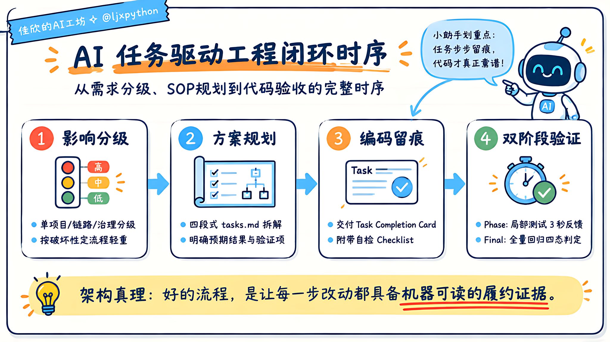
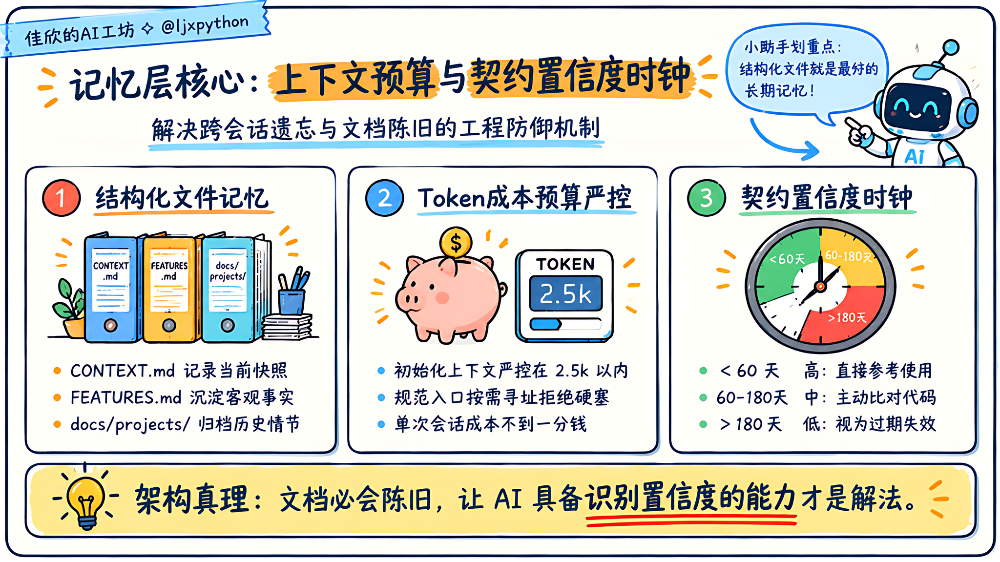
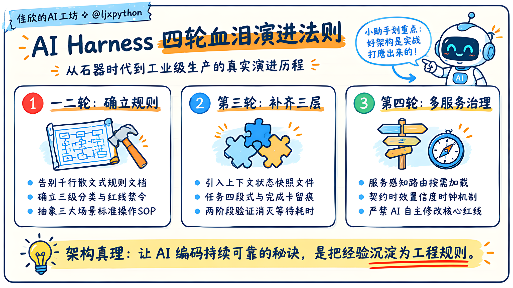

# AI Harness 实战：在 ai-agent-platform 中的六层落地与四轮血泪史


> **导读**：本文是[《AI Harness：让 AI 在你的项目里真正可靠工作（理论篇）》](2026-10-19-ai-harness-theory.md)的配套实战篇。  
> 理论篇讲清楚了什么是六层 Harness、为什么必须由工程环境约束大模型；本篇则把聚光灯对准真实复杂的微服务项目，全盘公开我们是如何在代码库中一步步踩坑、重构、推导出演进规范的。

---

## 🌟 开源项目实战背景：关于 ai-agent-platform

本文记录的每一条规则、每一个完成卡模板和每一轮血泪迭代，均直接发生在真实开源项目 **[ai-agent-platform](https://github.com/ljxpython/ai-agent-platform)** 的研发演进中。

- **开源项目地址**：👉 [https://github.com/ljxpython/ai-agent-platform](https://github.com/ljxpython/ai-agent-platform)
- **定位**：企业级 AI Agent 平台底座，专为快速二次开发与生产落地而生。
- **技术底座**：
  - **核心编排**：全面基于主流 **LangGraph** 与 **LangChain** 运行时生态；
  - **设计范式**：深度吸收并封装了 **deepagents**、**open-swe** 与 **deer-flow** 的多智能体协作与代码工程思想；
  - **三层微服务拓扑**：
    ```text
    platform-web (Vue 3 + Vite)          # 现代化控制台、交互式工作台
          ↓ (受管契约通信)
    platform-api (FastAPI + PostgreSQL)   # 鉴权治理、多租户、审计回溯、模型 Catalog
          ↓ (动态装配)
    runtime-service (LangGraph + Redis)  # 状态机持久化、MCP 装配、HITL 人机审批
    ```
- **新手小白与企业二开两相宜**：
  - 🐣 **新手小白首选**：直接进入 `apps/runtime-service/src/runtime_service/services/demo/showcase_demo/`，这是我们为初学者打磨的最小样板间。不需要啃几万行大项目，5 分钟即可跑通**工具调用 (Tool Calling)**、**人机协同审批中断 (HITL)**、**MCP 工具动态集成**与**沙箱工作区产物生成**！
  - 🚀 **企业级工业实战**：平台内置了标杆级多模式智能体 **`DeerFlow Agent`**，自带全流程规划（Planning）、代码研发（Coding）、研究探索（Research）动态模式切换，集成了生产级长期记忆管线（Memory Pipeline）和真实 PTY 交互终端。

在多语言、多服务协同的微服务架构下，如果没有明确的环境约束，AI 改动代码时会频繁破坏跨服务契约，迅速搞崩整条调用链路。

---

## 一、跨主流 AI 工具生态落地对照表（抄作业指南）

本文以 **Antigravity**（Google DeepMind 编程助手体系）作为落地载体，但**AI Harness 的本质是软件工程哲学，绝对不受特定工具绑定**。

无论你的团队使用的是 Cursor、Claude Code 还是 Windsurf，都可以无缝对照下表直接映射：

| Harness 层次 | 核心职责 | Antigravity 落地 | Cursor 落地 | Claude Code 落地 | 通用 IDE / CLI |
|---|---|---|---|---|---|
| **约束层** | 行为红线、服务路由 | `AGENTS.md` (全量加载) | `.cursor/rules/*.mdc` | `CLAUDE.md` | 项目根目录主规范 |
| **流程层** | 场景标准作业程序 (SOP) | `.agents/skills/*/SKILL.md` | 场景级 Rules / Prompt Files | `commands/` / workflows | 规范 SOP 文档 |
| **工具层** | 受控动作、高危拦截、MCP | 原生工具 + MCP 配置 | Cursor Tools / MCP 插件 | 终端权限拦截 + MCP | 统一 MCP 协议 |
| **记忆层** | 会话状态快照与契约 | `docs/CONTEXT.md` + `standards/` | 同左 (纯 Markdown 跨工具) | 同左 | 同左 (文件系统即记忆) |
| **可观测层** | 履约证据与两阶段测试 | Task Completion Card | 同左 (强制要求输出卡片) | 同左 | Git 提交模板与测试日志 |
| **反馈层** | 经验高密度蒸馏沉淀 | `docs/lessons/*.md` | 同左 (按领域维护踩坑文件) | 同左 | 研发踩坑知识库 |

---

## 二、约束层实战：把 AGENTS.md 锻造成项目“宪法”

### 1. 约束层的致命教训：严防散文与流水账
在初始版本中，我们的 `AGENTS.md` 写了上千行，洋洋洒洒像一篇产品说明书。结果 AI 在阅读时“选择性失明”，经常漏掉关键的 lint 规约，甚至在未跑测试的情况下私自修改公共模块。

**重构决断：结构化、表格化，严禁抒情散文！**
- 每一小节独立回答一个特定的工程问题；
- 规则只用两种表现形式：**清晰的判定决策表** 与 **带标记的负向列表**。

### 2. 改动三级分类落地
在 `ai-agent-platform` 中，我们制定了严格的分级执行标准：

```
单项目改动  ──▶  单服务内部实现调整，不触碰公共接口
                【规则】：直接编码 ➔ 跑局部单元测试 ➔ 本地 Commit

链路改动    ──▶  涉及 platform-api ⟷ runtime-service 契约、数据模型重构
                【规则】：激活 plan-project ➔ 拆解 tasks.md ➔ 双阶段验证

治理改动    ──▶  涉及数据库表迁移 (Alembic)、安全鉴权逻辑、生产部署环境
                【规则】：方案设计 ➔ 强制等待人类工程师评审批准 ➔ 方可编码
```

### 3. 反模式禁令清单（真金白银踩出来的 6 条红线）
我们将正向建议全面重构为**负向硬约束**，AI 的遵从率直接从不足 60% 飙升至接近 100%：

```markdown
## 严禁行为（红线禁区）
- ❌ 不得在未创建 tasks.md 的情况下开始编写跨服务链路代码
- ❌ 不得将局部 Phase 验证结果写进 Final 验证区块，二者严格物理隔离
- ❌ 不得在模板升级时将旧文档原地保留——必须在首部打上废弃（Deprecated）标注
- ❌ 不得自行裁决并批准治理与架构级改动，必须显式等待人类确认指令
- ❌ 不得编造或伪造测试结果，验证记录必须来自真实终端执行的标准输出
- ❌ 不得把 implementation/ 细节目录作为进度判定来源，进度唯一事实源为 tasks.md
```

### 4. 服务感知路由：消灭技术栈思维污染
当开发人员让 AI 修改前端 `platform-web` 时，AI 偶尔会习惯性写出 Pythonic 的字典访问风格，或者忽略 Pinia 状态流转。

解法是在 `AGENTS.md` 中建立精简路由表：

```markdown
### 服务规范路由表
改动涉及某个服务时，在读取 CONTEXT.md 后、开始写代码前，必须先读取对应入口：

| 服务模块 | 规范入口文档 | 核心技术栈 |
|---|---|---|
| platform-web | docs/frontend-development-playbook.md | Vue 3 + Tailwind + Vite |
| platform-api | docs/handbook/README.md | FastAPI + SQLAlchemy |
| runtime-service | docs/standards/README.md | LangGraph + GraphHarbor |

👉 跨服务改动时，强制额外读取 docs/standards/README.md（跨服务规范健康表）。
```
AGENTS.md 自身仅占用 1.2k Tokens，成为极速寻址的“交通枢纽”。

---

## 三、流程层实战：三个核心 Skill 的闭环协同

流程层将复杂的软件研发动作固化为标准 SOP。我们提炼了贯穿全生命周期的三个核心 Skill：



### 1. `plan-project`：方案规划与 tasks.md 四段式拆解
当改动被判定为链路或治理级时，强制触发该 Skill。它负责在 `docs/projects/{YYYYMMDD}-{项目名}/` 目录下生成标准工程蓝图。

**核心杀手锏：tasks.md 必须执行四段式结构！**
- ❌ **过去粗糙的任务写法**：
  ```markdown
  - [ ] 重构 RuntimeConfig 数据模型
  ```
  AI 看到这行字，改完某个字段就声称“搞定了”，没人知道它改了什么，也没跑测试。
- ✅ **工业级四段式任务标准**：
  ```markdown
  ### Task 1.1: 重构 RuntimeConfig 为 dataclass 强类型
  - **改动内容：** 将原字典解析逻辑重构为 dataclass，支持嵌套属性反射
  - **代码位置：** `apps/runtime-service/src/models/config.py` → `RuntimeConfig`
  - **预期结果：** 向后兼容现有 model_config 结构，且入参非法时抛出 ValidationError
  - **验证项：** `pytest tests/test_runtime_config.py` → 12/12 全部通过
  - **当前状态：** `[x]` 已完成 (2026-09-21)
  ```
  没有“预期结果”，验收就没有基准；没有“验证项”，任务完成与否全靠 AI 自说自话。

### 2. `implement-feature`：任务完成卡与现场履约
每写完一段代码，AI 必须现场交付一张 **Task Completion Card**，包含自检 Checklist：
```markdown
### Task 1.1: 重构 RuntimeConfig ✅ [2026-09-21]
- **改动内容：** 重构为 dataclass 强类型结构
- **代码位置：** `apps/runtime-service/src/models/config.py`
- **预期结果：** 完美解析嵌套配置，向后兼容 v1
- **验证项：** `pytest tests/test_runtime_config.py` → ✅ 12/12 通过 (0.38s)
- **合规自检：**
  - [x] 仅改动目标文件，无无关代码入侵
  - [x] 真实执行了对应单测且全绿
  - [x] tasks.md 状态已同步更新
  - [ ] CONTEXT.md 已更新（本任务未引发对外状态变化，合规跳过）
```

### 3. `verify-change`：两阶段验证彻底消灭等待灾难
- **Phase 局部验证**：任务执行中，仅跑与该 Task 直接绑定的微测试集（5秒内返回），保证心流不被打断；
- **Final 全量验证**：所有任务打勾后，一次性跑通全链路集成测试，执行四态判定（done / partial / blocked / deferred）。

---

## 四、工具层实战：给大模型装上受控的手臂

### 1. 挂载 LangChain / LangGraph 实时生态 MCP
在大模型时代，框架升级极快（例如 LangGraph 0.1 到 0.2 的状态机语法变革）。AI 极容易凭借其预训练知识，写出早已过时的语法。

我们在 `.agents/mcp_config.json` 中配置了两个核心 MCP：
- `langchain-docs`：官方文档语义检索接口；
- `langchain-reference`：最新 API 符号与函数签名速查。

同时在 `AGENTS.md` 写入硬性指引：“涉及 LangGraph 图节点与状态装配时，必须先调取 MCP 查询当前签名，严禁凭借旧记忆盲目编码”。

### 2. 危险操作熔断机制
在执行系统命令时，对于包含 `rm -rf`、`git reset --hard`、`alembic upgrade` 等高危动作，工具层必须挂起并输出拦截提示，强制获取人类二次授权。

---

## 五、记忆层实战：构建跨会话的工程事实源

### 1. 核心快照文件：`docs/CONTEXT.md`
这是专供 AI 快速进入角色的同步文件。**它的核心原则是：极简、只保留当前活跃事实，严禁堆砌历史垃圾！**

```markdown
# 项目当前状态 - AI 快速上下文

## 最后更新
2026-09-21 | 跨服务错误 Envelope 标准实施完毕

## 各服务活跃状态
| 服务 | 当前稳定性 | 最新关键约束 |
|---|---|---|
| runtime-service | 🟢 稳定 | 新版图引擎必须通过 GraphHarbor 恢复状态 |
| platform-api | 🟡 迭代中 | 组织隔离租户中间件重构中，注意传递 X-Tenant-Id |
| platform-web | 🟢 稳定 | 页面状态统一由 Pinia 管理，禁止直接跨层透传 |

## 近期核心架构决策
- 09-18: 确定 Agent 运行时使用状态持久化中间件而非全内存调度
- 09-21: 跨服务错误结构统一收敛至 error-envelope 标准
```
新会话开始时，AI 只需花费 300 Tokens 读完该文件，就能在 10 秒内完整“复活”上一次的工程上下文！

### 2. 跨服务契约时效衰减机制（`docs/standards/`）
我们在 `docs/standards/` 下管理所有微服务间的通信契约，并给每个契约标明置信度元数据：



```markdown
---
status: active
last_verified: 2026-09-27
confidence: high
source_project: docs/projects/20260926-error-response-contract/
---

# 统一错误响应 Envelope 规约
...
```

- 🟢 `confidence: high`（验证时间 < 60 天）：直接生效；
- 🟡 `confidence: medium`（60 ~ 180 天）：参考生效，但改动前需对比代码；
- 🔴 `confidence: low`（> 180 天）：视为失效过期，AI 不得以此约束代码。

**这从根本上化解了“文档陈旧”带来的信任危机**——系统不再做“文档永远最新”的虚妄假设，而是赋予 AI 判定文档置信度的防御机制。

---

## 六、反馈层实战：错误蒸馏与经验自愈

### 1. 三层经验库架构
```text
Tier 1: AGENTS.md 严禁行为      ← 每次会话自动全量加载 (严格限制 ≤10 条)
Tier 2: docs/lessons/{service}.md ← 按命中服务按需加载 (每条 ≤4 行)
Tier 3: Git Log 与 ADR 归档     ← 永不主动加载 (人工排查调阅)
```

### 2. 我们真实的踩坑记录（节选自 `docs/lessons/ai-workflow.md`）
每一条教训都是血泪凝结，提炼后只有 4 行：

```markdown
## [坑] 模板升级时旧文档未加废弃标注
- **场景：** 项目从单任务模板升级为多专题复合模板时
- **错误：** 只新建了子文档，旧文档原地保留，后续会话的 AI 不知道以谁为准
- **正确：** 旧文档顶部显式注入废弃标注，README 导航表作为唯一权威入口
- **日期：** 2026-09-21

## [坑] implementation/ 目录被误作为进度来源
- **场景：** 链路与治理改动逐步实现阶段
- **错误：** AI 去 implementation/ 翻找文件碎片来判断进度，导致 tasks.md 长期脱节
- **正确：** tasks.md 是项目进度唯一法定来源，实现目录仅作细节代码归档
- **日期：** 2026-09-21
```

---

## 七、四轮真实迭代演进：痛点倒逼出的架构体系

这套工业级体系不是一天在白板上空想出来的，而是被真实开发过程中的各种翻车惨案一路倒逼出来的。

```
第一轮 (基础约束)  ──▶  第二轮 (SOP 流程)  ──▶  第三轮 (记忆与可观测)  ──▶  第四轮 (多服务治理与进化边界)
```

### 第一轮：只有基础约束（石器时代）
- **做法**：在根目录下放了一个几百行的初版 `AGENTS.md`，写满了功能介绍和软性建议。
- **翻车惨状**：AI 答非所问，改动时经常漏掉关键文档，偶尔心情不好顺便重构了隔壁服务的公共代码。

### 第二轮：引入三大 SOP（进入工业分工）
- **做法**：抽象出 `plan-project`、`implement-feature` 和 `verify-change` 三个操作 Skill。
- **暴露的残酷新痛点**：
  1. `AGENTS.md` 和 Skill 内容大量重复，一旦改了一边，两边打架，AI 精神分裂；
  2. 任务列表只写一句话，改没改对全靠感觉；
  3. 新开一个对话，AI 完全不记得项目处于什么阶段，必须重新打字同步半天；
  4. 每改一个函数就跑 10 分钟全量测试，开发效率几乎归零。

### 第三轮：补齐记忆、可观测与反馈三层（形成闭环）
针对第二轮的痛点，实施精准打击：
- 引入 **`CONTEXT.md`**：彻底消灭会话间的信息差；
- 引入 **四段式 tasks.md + Task Completion Card**：把合规性牢牢锁死在交付产物中；
- 引入 **Phase + Final 两阶段验证**：解决测试耗时灾难；
- 引入 **三层经验库与 ≤4 行蒸馏法**：确保踩过的坑不再重蹈覆辙。

### 第四轮：多服务契约治理与自我进化边界（迈入成熟期）
当微服务体系膨胀至三个子工程后，出现新挑战：各技术栈范式冲突、跨服务契约缺乏统一标准、经验沉淀依然高度依赖人工催促。
- **解法一（服务感知路由）**：`AGENTS.md` 瘦身为纯路由，精准指向对应技术栈 Playbook；
- **解法二（契约置信度衰减）**：建立 `docs/standards/`，带时间衰减元数据，解决文档陈旧矛盾；
- **解法三（收尾强制复盘）**：项目收尾时 AI 必须主动发起踩坑经验提炼提案；
- **解法四（锁死进化边界）**：明确制定铁律——**AI 严禁自主篡改约束层与流程层！** 约束层的演进必须有人类工程师严格把关。

### 四轮演进小结（知识卡片）



---

## 八、多人协作与 Git 冲突防御策略

很多工程师会问：在团队多人并行给 AI 派活时，`CONTEXT.md` 和 `tasks.md` 频繁修改，会不会导致天天解决 Git 冲突？

我们在 `ai-agent-platform` 的实践中总结了两条铁律：
1. **任务目录物理隔离**：每一个特性项目独占 `docs/projects/{date}-{feature}/` 目录，多人在各自的分支中推进自己的任务卡，互不干扰；
2. **CONTEXT.md 的分支局部快照策略**：分支内的 `CONTEXT.md` 仅追踪当前分支关心的局部状态；分支合并回主干（main）时，采用 Squash & Merge 策略，由主干发布流程或 CI 统一更新全局快照的一致性。

---

## 九、客观复盘：当前的局限性

我们坚持求真务实，目前的 AI Harness 体系仍有以下几个已知的工程局限：

1. **Skill 缺乏底层强制 Hook**：目前的 Skill 依然依赖大模型的主动语义识别。如果触发描述不够锋利，模型可能偶发跳过流程（应对手段：约束层配置严禁行为兜底）。
2. **纯文件系统尚无语义向量检索**：历史归档文档依赖目录树寻址，跨半年的深层历史决策检索效率依然依赖人工指定路径。
3. **完成卡自检仍有信任假设**：虽然 Task Completion Card 大幅提升了合规率，但自检项目前仍由大模型自身填写，依然需要人类保持 5 分钟抽查机制。

---

## 十、结语：把 AI 当成刚入职的高级实习生

不要把 AI 想象成全知全能的上帝，也不要把它的失误归咎于“智商不行”。

在工业级工程体系中，**你应当把 AI 视为一个智力超群、打字飞快、但极度缺乏安全感且毫无持久记忆的高级实习生**：
- 如果你没有详尽的规约，它就会按自己的习惯天马行空；
- 如果你没有留痕的完成卡，它为了交差就会顺口说谎；
- 但只要你为它构建好完备的 **AI Harness**——划定清晰红线、铺好操作流程、准备好记忆快照、架起测试防线，它就能爆发出超越人类工程师十倍的惊人生产力！

---

## 🛠️ 欢迎体验与交流

本文涉及的所有架构图、流程设计与落地细节，均在开源项目 **[ai-agent-platform](https://github.com/ljxpython/ai-agent-platform)** 中完全透明公开。

- 无论你是想学习 **LangGraph / LangChain** 的生产级二次开发；
- 还是想在自己的团队中搭建一套坚不可摧的 **AI 研发 Harness**；

👉 **欢迎访问项目仓库，体验 Demo 智能体，或在 Issue 共同交流：**  
🔗 [https://github.com/ljxpython/ai-agent-platform](https://github.com/ljxpython/ai-agent-platform)
