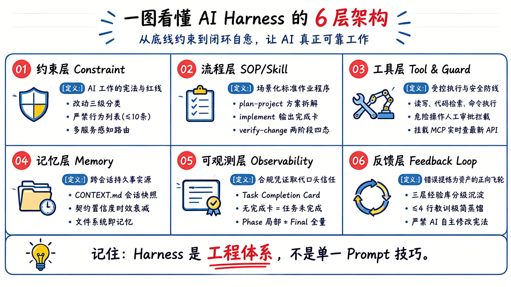
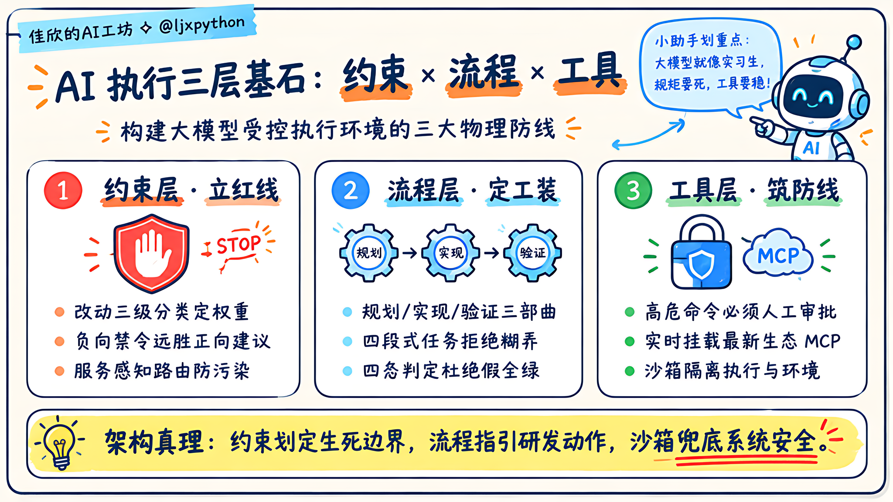
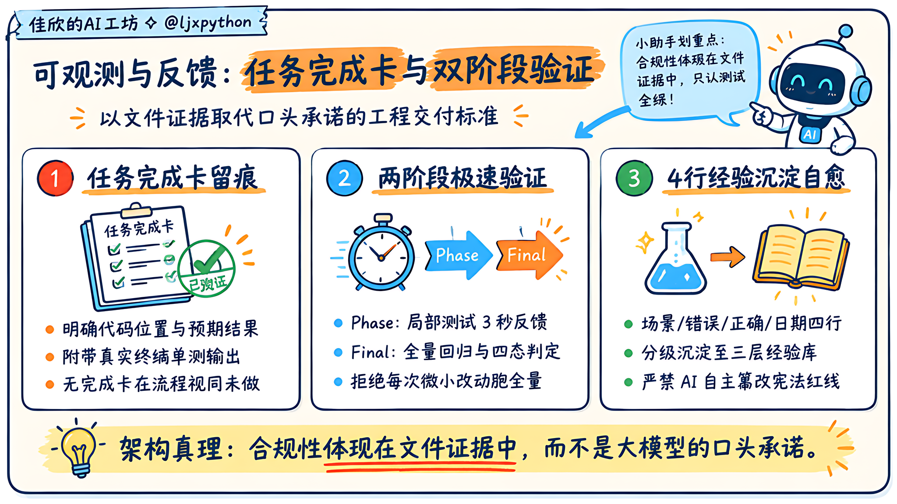

# AI Harness：让 AI 在你的项目里真正可靠工作


> **Prompt 只能解决单次提问，解决不了工程交付。本文介绍如何通过约束、流程、工具、记忆、可观测与反馈六层架构，在真实项目中构建确定性的 AI 运行环境（AI Harness）。**

---

## 🌟 开源项目导读：关于 ai-agent-platform

> 💡 **先睹为快 / 真实生产级代码参考：**
> 
> 本文沉淀的所有 Harness 治理思想与工程落地规范，全部源自开源项目 **[ai-agent-platform](https://github.com/ljxpython/ai-agent-platform)**。
> 
> - **开源地址**：👉 [https://github.com/ljxpython/ai-agent-platform](https://github.com/ljxpython/ai-agent-platform)
> - **技术底座**：全面基于主流 **LangGraph** 与 **LangChain** 生态体系，深度吸收并封装了 **deepagents**、**open-swe** 与 **deer-flow** 的前沿工业级设计范式。
> - **生产级特性开箱即用**：控制面（FastAPI + PostgreSQL）与 Agent 执行引擎（LangGraph + GraphHarbor 状态机持久化）完全解耦，原生支持 HITL 人机协同审批中断、交互式终端 PTY、受控沙箱工作区及标准 MCP 工具矩阵。
> - **新手小白极速上手**：无需担心架构复杂！仓库贴心内置了面向初学者的最小样板间 **`showcase_demo`**，新手小白可以 5 分钟快速跑通 Tool Calling、人机审批、MCP 工具装配与产物实时预览；想要冲击工业级复杂落地的同学，也可以直接参考内置的标杆级多模式智能体 **`DeerFlow Agent`**。
> 
> 如果你正在寻找一个能直接二次开发、结构清晰规范的企业级 Agent 平台底座，欢迎点击上方链接给项目点个 Star ⭐️！

---

## 一、你有没有遇到过这些情况？

你告诉 AI："按我们的规范来，改完之后更新文档。"

AI 点头（比喻），改完代码，文档没更新。

你又说一遍。下次还是这样。

或者：你和 AI 讨论了半小时，敲定了一个架构决策，新开一个会话继续，AI 完全不知道之前说了什么，一切从零开始。

或者：AI 信心满满地说"我已经按照流程全部做完了"，但你翻了半天找不到任何验证记录，不知道它到底改了哪些地方、做没做完、测没测过。

这些不是 AI 模型的智商问题，而是它的**运行环境（Harness）**存在系统性缺陷。

---

## 二、Prompt 工程 ≠ AI Harness

大多数团队在 AI 辅助编程或 Agent 集成上，常常止步于 Prompt 工程——写一段很长的系统提示词（System Prompt），罗列一长串规则，期望 AI 凭着自觉全盘照做。

这种做法在做简单 Demo 时有效，但在生产级软件工程中上限极低。

| 评估维度 | 传统 Prompt 工程 | 工业级 AI Harness |
|---|---|---|
| **关注点** | 怎么向 AI 提问（输入技巧） | AI 在什么环境与制度下工作（工程基础设施） |
| **作用范围** | 单次会话（临时、易遗忘） | 跨会话、跨任务、跨多人团队（持久有效） |
| **可维护性** | 一个人改 Prompt，全局行为不可预测 | 分层解耦设计，按需挂载与修改 |
| **可验证性** | AI 口头宣称完成，人类只能盲信 | 以文件和真实测试产物为履约证据 |
| **核心隐喻** | 给临时工发了一封要求很多的邮件 | 为团队设计了完备的研发规范与生产流水线 |

**AI Harness 的本质定义：**
让 AI 能够在你的软件工程体系里，**可靠、可观测、可自愈、可迭代工作**的完整运行环境。

它不是单一的提示词咒语，而是一套严谨的软件系统工程——包含**约束层、流程层、工具层、记忆层、可观测层、反馈层**六大维度。

---

## 三、六层架构与协同运行拓扑

千言万语不如一张清晰的架构拓扑图。在生产实践中，这六层构成了一个闭环运转的控制系统：



这六层形成了**自上而下的边界约束**与**自下而上的数据与反馈闭环**：
- **约束层**是总纲宪法，划定生死红线与路由分流；
- **流程层**是执行细则（SOP），按需激活指导动作；
- **工具层**提供受控的手臂与防越权沙箱；
- **记忆层**提供跨会话持久存在的事实源；
- **可观测层**留下机器可判定的履约证据与测试记录；
- **反馈层**从每次犯错中蒸馏高密度教训，反哺进化整个系统。

六层缺一不可：没有约束，流程就是空文；没有记忆，每次对话都在从零重建；没有可观测性，你永远处于疑神疑鬼的状态；没有反馈，同样的 Bug 会在下个会话精准复现。

下面我们逐层拆开，看看每一层的核心设计要义。

---

## 四、约束层（Constraint Layer）——规定 AI 的行为边界

### 1. 是什么
约束层是 AI 在当前项目工作的"宪法"——规定什么能做，什么绝对不能做，遇到什么情况必须走什么流程。

在工程实践中，约束层通常表现为项目根目录的核心入口文件：
- 在 **Antigravity** 中为 `AGENTS.md`；
- 在 **Cursor** 中为 `.cursor/rules/*.mdc` 或 `.cursorrules`；
- 在 **Claude Code** 中为 `CLAUDE.md`；
- 在 **Windsurf / Copilot** 中为各自主指令文件。

### 2. 核心设计原则

#### 原则一：改动三级分类，按影响面定流程权重
很多团队最大的错误是用“代码修改行数”来评估流程重量。改一行配置如果破坏了跨服务的通信契约，其破坏力远大于在内部重构几百行工具函数。

我们推荐用**“影响范围与契约破坏性”**进行三级定性分级：
- **单服务/单项目改动**：局限于模块内部，不影响任何对外接口与数据模型。  
  👉 **流程**：直接写代码 → 运行局部单测 → Commit，零额外文档负担。
- **链路级改动**：涉及跨服务通信、公共库升级、接口 Envelope 变更。  
  👉 **流程**：方案规划（plan-project） → 拆解 tasks.md → 逐步实现 → 跨服务链路测试 → 验证收尾。
- **治理/架构级改动**：涉及认证鉴权、生产配置、数据库表结构变更、数据迁移。  
  👉 **流程**：方案规划 → **强制人工评审与确认** → 实施 → 全面回归测试。

#### 原则二：反模式禁令（Negative Constraints）远比正向建议有效
这是老工程师反复踩坑验证出来的黄金定律：

> ❌ **正向建议（弱约束）**：“AI 应该在开始改动前先判断级别并编写设计文档。”  
> ✅ **负向禁令（强约束）**：“AI 严禁在未创建 tasks.md 的情况下开始编写跨服务改动的代码。”

前者是方向性建议，大模型往往在上下文变长时选择性忽略；后者描述的是一个**极其明确的不合法状态（Illegal State）**，大模型的遵从率会呈现数量级提升。

> [!IMPORTANT]
> **禁令上限控制**：约束层的核心“严禁行为”建议严格控制在 **≤ 10 条**。超过 10 条说明约束层职责不聚焦，应该下沉至流程层（SOP）或领域踩坑库（Lessons）。

```markdown
## 严禁行为（硬性红线）
- ❌ 不得在未建 tasks.md 的情况下开始写跨服务改动的代码
- ❌ 不得把局部 Phase 验证结果充当最终 Final 验证结论
- ❌ 不得自行批准架构与治理级改动，人工明确评审确认是硬性前置条件
- ❌ 不得编造测试结果，所有验证输出必须基于真实执行命令产物
- ❌ 不得在未标记废弃前原地保留已失效的旧契约文档
```

#### 原则三：多服务架构下的“服务感知路由”
在包含前端（Vue/React）、后端（FastAPI/Go）与 Agent 执行器（LangGraph）的现代项目中，把所有服务的开发细节全塞进根目录约束文件会导致其体积膨胀。这不仅浪费 Token，还会引发跨技术栈的思维污染（例如 AI 用 Python 的思维去写 Vue 的响应式代码）。

**解法：约束层只做路由，规范入口按需寻址。**

```markdown
| 服务模块 | 规范入口文档 | 核心技术栈 |
|---|---|---|
| platform-web | docs/frontend-playbook.md | Vue 3 + Tailwind |
| platform-api | docs/api-handbook/ | FastAPI + SQLAlchemy |
| runtime-service | docs/agent-standards/ | LangGraph + Redis |
```
AI 命中特定服务改动时，再去读取对应的子规范。职责分离，上下文极其精准。

---

## 五、流程层（SOP / Skill Layer）——封装标准操作细则

### 1. 是什么
如果约束层是“宪法”，流程层就是各领域的“标准操作程序（SOP）”。在实践中，每个 SOP 通常沉淀为独立的 Skill（或自定义工作流指令），描述**触发条件、标准步骤、产物模板与交付物规范**。

### 2. 最小高可用流程三部曲

一套能完美支撑复杂工程开发的最小 SOP 集合：

1. **`plan-project`（规划 SOP）**：
   - **触发**：判定为链路改动或治理改动时。
   - **产出**：标准项目工程目录，包含方案设计、四段式任务列表（tasks.md）、验证方案。
2. **`implement-feature`（实现 SOP）**：
   - **触发**：计划已确认，进入具体编码阶段。
   - **产出**：代码变更 + 每一阶段的 **Task Completion Card（任务完成卡）**。
3. **`verify-change`（验证 SOP）**：
   - **触发**：所有任务编码完毕，准备交付收尾。
   - **产出**：全量回归记录 + 状态四态判定（`done` / `partial` / `blocked` / `deferred`）。

> [!TIP]
> 为什么要用四态判定，而不是简单的“通过/失败”？
> 在工业级项目中，`blocked` 明确指出了外部依赖阻碍（如第三方 API 故障），`deferred` 明确记录了主动推迟实施的非关键点。这能完全杜绝 AI 为了汇报“全绿”而掩盖真实工程瑕疵。

### 3. 任务结构的四段式工业标准
在 tasks.md 里，每一个子任务都必须能独立回答四个核心问题，缺一不可：

```markdown
### Task 1.1: 重构 RuntimeConfig 数据配置类
- **改动内容：** 将原字典配置结构重构为 dataclass 强类型结构
- **代码位置：** `apps/runtime-service/src/models.py` → `RuntimeConfig`
- **预期结果：** 支持新版 model_config 配置注入，且完全向后兼容旧版 v1 结构
- **验证项：** `pytest tests/test_runtime_config.py` → 100% 通过
```

---

## 六、工具层（Tool Layer）——受控执行能力与安全防线

工具层定义了 AI 能在你的系统里调用哪些动作（读写文件、语法分析、命令执行、MCP 插件）。

除了常规的读写工具之外，工业级 Harness 必须具备两个核心机制：

### 1. 高危操作熔断守卫（Danger Guard）
AI 在执行高风险操作前，必须强制挂起并弹出人类审批拦截，严禁静默执行：
- 文件系统批量删除、移动核心目录；
- 生产环境/主干分支的 `git push`、`git reset --hard`；
- 数据库结构变更（DDL）、表数据批量覆写；
- 敏感生产环境变量修改。

### 2. 协议级工具扩展（MCP - Model Context Protocol）
避免让 AI 在命令行中瞎拼 curl 命令或查阅本地早已过期的依赖包。通过 MCP（例如挂载 LangGraph 官方 Docs MCP、内网 OpenAPI MCP），让 AI 能够实时调取最新 API 契约，彻底杜绝凭过时记忆写出废弃 API。

### 3. 执行三层小结（知识卡片）



---

## 七、记忆层（Memory Layer）——终结 AI 会话遗忘症

### 1. 核心问题
大模型本身是没有跨会话记忆的。每一次点击“新会话”，AI 都是一个完全初来乍到的“失忆症患者”。

很多团队试图用复杂的向量数据库来做全量记忆检索，结果往往是把几周前的废弃聊天记录捞出来，反而把 AI 的上下文彻底搞混。

### 2. 工程解法：结构化文件系统就是最好的持久记忆
把 AI 需要记忆的一切，沉淀为软件工程代码仓库中的标准 Markdown 文件。

| 记忆分类 | 对应人类认知 | 存放位置 | 承载内容 |
|---|---|---|---|
| **快照记忆** | 当前在干嘛 | `docs/CONTEXT.md` | 项目当前健康度、各服务状态、最新决策（极短） |
| **语义记忆** | 系统的客观事实 | `docs/FEATURES.md` | 系统具备哪些完整业务能力、端点清单 |
| **情节记忆** | 过去的经历与来龙去脉 | `docs/projects/` | 历史项目方案、技术决策记录（ADR） |
| **程序记忆** | 解决套路与肌肉记忆 | `skills/` | 标准作业 SOP 与应对策略 |

### 3. 上下文工程与 Token 成本预算控制
每次新开会话，很多同学担心上下文被撑爆。这就需要严格遵循**上下文预算原则（Context Budgeting）**：

```
┌────────────────────────────────────────────────────────┐
│                   新会话上下文预算分配表                  │
├────────────────────────┬───────────────┬───────────────┤
│ 载体                   │ 推荐 Token 预算│ 加载时机      │
├────────────────────────┼───────────────┼───────────────┤
│ AGENTS.md (约束总纲)   │ ≤ 1,500 Tokens│ 每次自动加载  │
│ CONTEXT.md (当前快照)  │ ≤ 500 Tokens  │ 每次自动加载  │
│ 服务专用 Playbook      │ ≤ 1,000 Tokens│ 命中服务时路由│
│ 契约文件 (standards/)  │ ≤ 800 Tokens  │ 跨服务按需加载│
│ 踩坑库 (lessons/)      │ ≤ 300 Tokens  │ 命中模块按需读│
└────────────────────────┴───────────────┴───────────────┘
```
**总初始化上下文严控在 2,000 ~ 3,000 Tokens 以内**，花费不到 1 分钱，却换来了 AI 百分之百精准的项目全局感知！

### 4. 契约时效与置信度动态衰减（Confidence Decay）
文档必会陈旧，这是不可违抗的软件工程物理定律。
Harness 的核心设计不是强行要求文档“永远最新”，而是**让 AI 具备识别文档可信度的能力**。


在契约文件顶部加入时效元数据：
```markdown
---
status: active
last_verified: 2026-09-27
confidence: high       # high(<60天) / medium(60-180天) / low(>180天)
source: docs/projects/error-contract/
---
```
AI 在读取文档时首先核对置信度：
- 🟢 **high**：直接作为设计依据；
- 🟡 **medium**：作为参考，但需主动比对代码真实实现；
- 🔴 **low**：判定为已过期，以当前运行代码为单一事实源，不得强行约束。

---

## 八、可观测层（Observability Layer）——合规证据取代口头承诺

### 1. 核心痛点
AI 告诉你：“所有单测我都跑通了，代码风格也完全符合规范，放心吧！”  
你信吗？在生产环境，谁信谁背锅。

### 2. 关键法则：合规性体现在文件证据中
你无法窥探大模型内部的神经元激活过程，但你可以严格校验它的**输出文件与验证留痕**。



**Task Completion Card（任务完成卡）：**
每一个子任务完成时，AI 必须生成机器与人类均可秒级校验的完成卡：

```markdown
### Task 1.1: 重构 RuntimeConfig ✅ [2026-09-21]
- **改动内容：** 将 RuntimeConfig 迁移为强类型 dataclass
- **代码位置：** `apps/runtime-service/src/models.py`
- **预期结果：** 向后兼容旧版配置并支持动态反射
- **验证项：** `pytest tests/test_runtime_config.py` → ✅ 12/12 通过 (0.42s)
- **合规自检：**
  - [x] 代码改动精准聚焦，无无关重构
  - [x] 验证项已在真实终端执行完毕并捕获输出
  - [x] tasks.md 状态已更新为已完成
  - [ ] CONTEXT.md 已更新（本任务未引发外部状态变更，跳过）
```
**核心硬规则：没有生成 Task Completion Card，在流程上等同于“该任务未开始”。**

### 3. 两阶段验证机制（Phase vs Final Verification）
- **Phase 局部验证**：每做完一个小 Task，只跑该 Task 绑定的局部最小测试集（3-5秒内反馈），保证小步快跑不阻塞；
- **Final 全量验证**：所有 Task 勾选完成后，统一触发全量回归测试、跨服务集成测试与状态一致性四处核对（README、tasks.md、verification.md、CONTEXT.md）。

---

## 九、反馈闭环层（Feedback Loop）——让教训沉淀为资产

### 1. 核心问题
AI 今天踩了一个坑，你耐心地打字纠正了它。明天新开一个会话，AI 毫无意外地在同一块石头上绊倒。

### 2. 三层经验库体系
针对不同生命周期的教训，分级存放：
- **Tier 1：约束层严禁清单**（`AGENTS.md`，始终加载，≤10 条全场景生死红线）；
- **Tier 2：领域踩坑文件**（`docs/lessons/{service}.md`，按需路由加载，高密度提炼）；
- **Tier 3：Git 历史与 ADR 归档**（仅在人工排查深挖时调阅）。

### 3. ≤ 4 行极简蒸馏法
严禁将大段错误日志直接贴入经验库。未提炼的日志会迅速占满上下文窗口，并干扰后续会话的检索精度。每一条教训必须遵循工业级提炼模板：

```markdown
## [坑] 契约模型变更未声明向后兼容
- **场景：** 跨服务 API 响应体重构时
- **错误：** 直接删除旧字段，导致前端控制台页面白屏
- **正确：** 实行双写/保留旧字段标记 deprecated，待前端升级完毕后再下线
- **日期：** 2026-09-21
```

### 4. Harness 自我进化的绝对红线
在项目开发中，我们可以赋予 AI 自动更新快照（`CONTEXT.md`）、自动提炼经验草案、自动升级契约状态（`draft` ➔ `active`）的权利。

> [!CAUTION]
> **绝对禁区**：**AI 绝对不允许自主修改约束层（AGENTS.md）与核心流程 Skills！**  
> 宪法和研发流程的修改必须由人类工程师进行 Code Review 与 Git 审查确认。失去人类控制权的自主闭环，最终必然导致工程规范的崩塌。

---

## 十、总结与从零实施路径

搭建 AI Harness 绝不需要你停下业务闭门造车一个月。推荐按以下四步稳妥推进：

1. **第 1 周（立宪法）**：写出第一版 `AGENTS.md`，明确改动三级分类与 5 条最核心的负向禁令；
2. **第 2 周（定流程）**：沉淀 `plan-project`、`implement-feature` 和 `verify-change` 三个基础 SOP，推行任务四段式；
3. **第 3 周（建记忆）**：引入 `CONTEXT.md` 快照与两阶段验证机制，彻底消灭会话遗忘与全量测试等待；
4. **长期演进（促闭环）**：推行每次改动收尾的 ≤4 行经验蒸馏，让你的项目上下文越跑越聪明。

### 全篇核心总结（知识卡片）


---

## 🔗 下篇预告与实战指引

理论讲清楚了，那么在真实的微服务、多技术栈项目中，这套体系到底是如何落地的？遇到了哪些惨痛的线上事故和搞笑的“翻车现场”？

👉 **欢迎继续阅读下篇：**  
[《AI Harness 实战：在 ai-agent-platform 中的六层落地与四轮血泪史》](2026-10-19-ai-harness-practice.md)

也再次推荐大家阅读本文对应的生产级开源底座 **[ai-agent-platform](https://github.com/ljxpython/ai-agent-platform)**，亲自跑一跑内置的 `showcase_demo`，感受工业级工程规范带给大模型编程的极致稳定与确定性！
