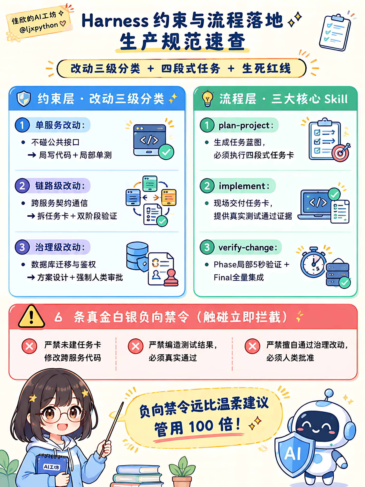
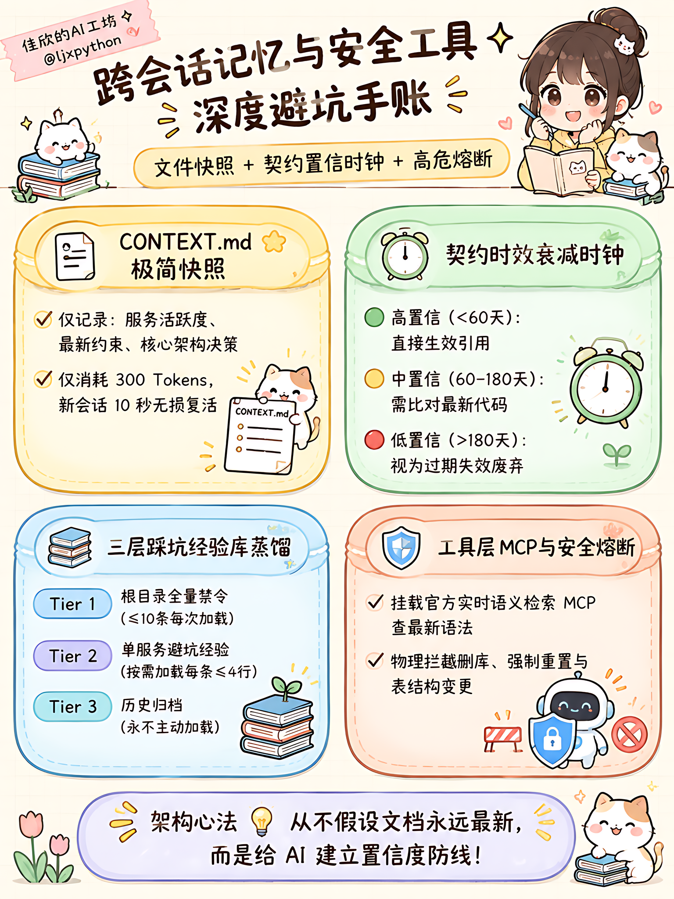

<!-- 
小红书 3:4 满屏超高密度图文流 (1152x1536):
P01 演进: 
P02 规约: 
P03 机制: 
P04 清单&底座: 
-->

# AI写代码崩了4次！我是怎么救回来的

宝子们！大模型写代码踩坑实录续集来啦！👩‍💻🔥
上期讲了理论，这期全是我们在真实开源项目中，真金白银翻车 4 次总结出的【血泪演进手账】！

之前让 AI 搞微服务：
不是偷懒改崩公共接口、就是测都没测假装做完、甚至顺手 rm 删库……😭
后来我们硬核重构，逼出了这套工业级外骨骼防线！

🌸 4 张超高密度手账干货速存：
1️⃣ 四轮演进史：从石器时代软性建议，一路杀到多服务治理与进化边界；
2️⃣ 约束与流程：改动三级分类定生死、四段式任务卡、局部5秒验证法；
3️⃣ 记忆与工具：CONTEXT.md 10秒复活、契约时效衰减时钟、高危操作物理熔断；
4️⃣ 防翻车清单：4 条不可逾越的红线禁令，照着自检告别深夜抢险！

⭐ 极客心法：
把 AI 当成高级实习生：给足规约、备齐记忆、架好防线，才能发挥十倍战力！

🎁 生产级底座开源啦！
我们在 GitHub 开源了全套真实落地代码：
👉 **github.com/ljxpython/ai-agent-platform** ⭐️
基于最新的 LangGraph + FastAPI 微服务拓扑，内置了 5 分钟极速上手的 demo 样板间（showcase_demo），人机审批、沙箱工具开箱即用！赶紧 Star 收藏抄作业吧～💕

#AI应用开发 #程序员日常 #手账指南 #系统架构 #大模型 #自学编程 #女生学编程 #微服务 #开源项目
