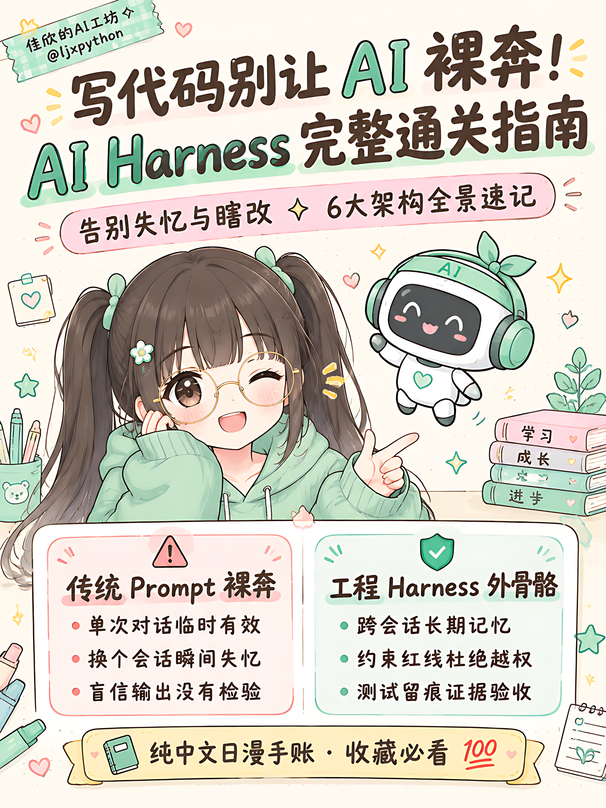
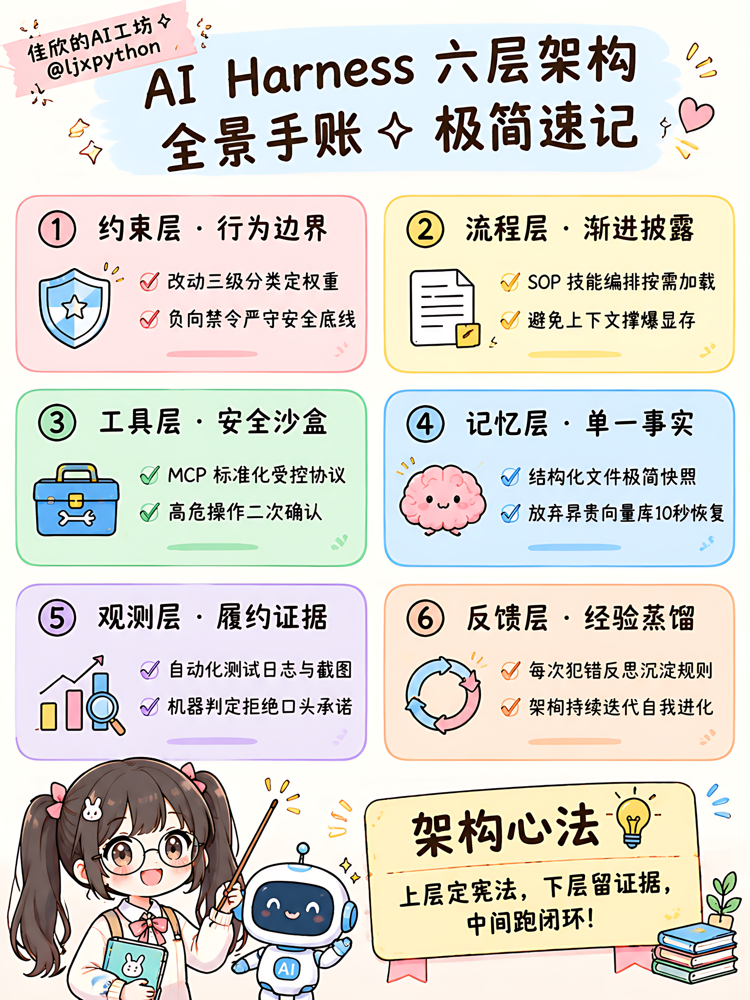
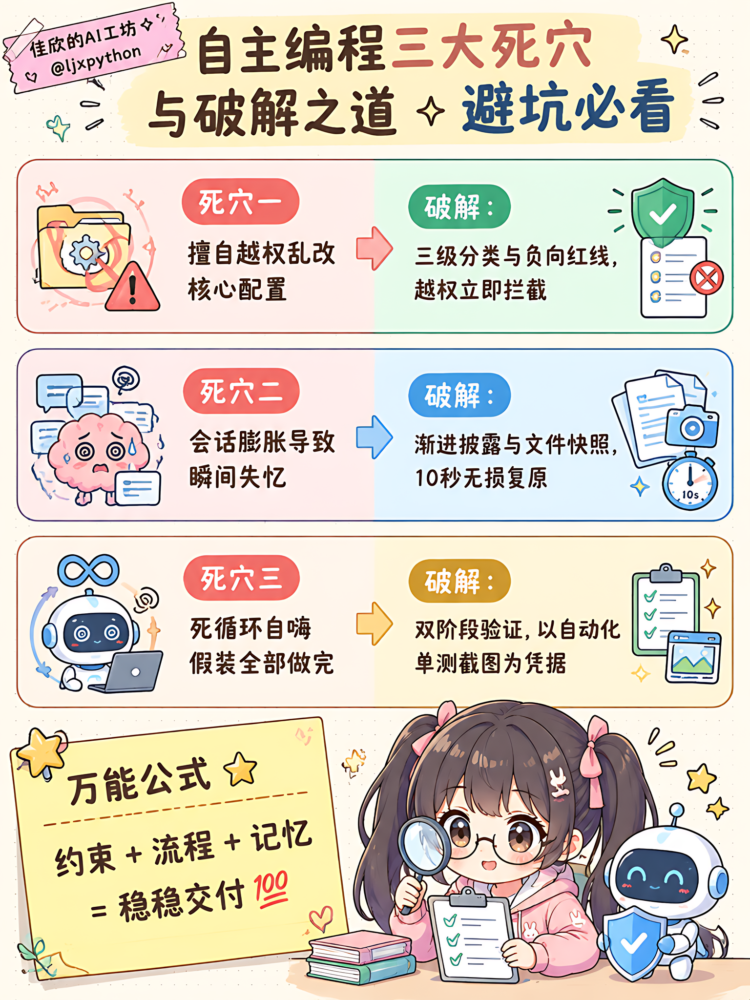

<!-- 
小红书 3:4 满屏高密度图文流 (1152x1536):
P01 封面: 
P02 架构: 
P03 深潜: 
P04 清单&广告: 
-->

# 别让AI裸奔啦！大模型外骨骼全景手账

宝子们！自学大模型编程是不是总遇到玄学报错？😭
让 AI 按照规范改代码，它嘴上答应，一转头改崩了隔壁核心文件；
聊了半小时敲定的方案，换个新会话立马失忆……

其实 Prompt 只能管单次提问，根本抗不住真实工程！
想要让 AI 靠谱干活，必须给它装上一套【外骨骼 Harness】！
熬夜给姐妹们整理了 4 张超高密度日漫手账卡，右滑速存～📖💖

🌸 4 张卡片吃透 Harness 理论全景：
1️⃣ 概念对比：Prompt 像发邮件，Harness 才是造流水线；
2️⃣ 六层全景：约束(定红线) ＋ 流程(SOP) ＋ 工具(沙盒) ＋ 记忆(文件) ＋ 观测(证据) ＋ 反馈(进化)；
3️⃣ 破解死穴：三级分类防越权、渐进披露防爆显存、双阶段验证防死循环；
4️⃣ 落地打卡：4 项工程自检清单，对照打勾拒绝加班！

⭐ 治愈万能公式：
约束 ＋ 流程 ＋ 记忆 ＝ 稳稳交付 💯

🎁 姐妹们的重磅福利来啦！
我们在 GitHub 开源了完整的生产级底座：
👉 **github.com/ljxpython/ai-agent-platform** ⭐️
基于最新的 LangGraph 架构，原生内置了小白样板间（showcase_demo），5 分钟就能无痛跑通 Tool Calling、人机审批和沙箱工具！赶紧去点个 Star 备用吧～💕

#AI应用开发 #程序员日常 #手账指南 #大模型 #自学编程 #女生学编程 #Cursor #前端开发 #学习打卡
