# AI 应用开发技术文章与面试视觉设计指南 (Design Guide)

> **单一真实源 (SSOT)**：本项目所有文章配图、思维导图、面试 Deck 与知识站插图的视觉规范与生图提示词母版均在此收敛维护。持续迭代，杜绝散乱。

> [!IMPORTANT]
> **🏛️ 架构图与系统拓扑选型绝对收敛决策**：
> 凡是**工业级系统架构（Architecture）、执行工作流（Workflow）、调用序列（Sequence）、数据流水线（Dataflow）、状态机生命周期（Lifecycle）**，**一律强制使用 `/archify` 生成自包含、高交互、正交无损矢量的 HTML/SVG 架构图**（统一收录至 `assets/architecture/`）！彻底弃用扩散生图大模型画架构图，根除文字乱码、几何变形与不可交互的硬伤。
> `gpt-image-gen` 严格聚焦其绝对长板：**概念隐喻头图、学霸手绘手账草稿、社媒互动图文卡片与日漫教程指南**。

---

## 🎨 视觉风格矩阵概览

根据读者心理与平台传播逻辑，本项目全面确立两大核心视觉流派：

| 流派编号 | 视觉风格名称 | 核心美学特征 | 适用场景 | 代表参考 |
|---|---|---|---|---|
| **Style 01** | **学霸手绘手账知识地图**<br>*(Sketchnote Knowledge Map)* | 浅米白纸纹、深蓝手绘大框、工整手写体、朱红高亮双圈、微简笔画、胶带便签 | AI 核心概念速记、面试必考要点、参数与对比清单、小红书图文轮播 | 用户参考图 1 |
| **Style 02** | **现代学院派方格手绘笔记**<br>*(Studygram Swiss Grid Note)* | 浅绿方格纸、三色半透明马克笔刷、左文右图、微引线标注、胶带小结便签 | 核心架构原理深度剖析、演化时间线、微架构流程链路 | 用户参考图 3 |
| **Style 03** | **极客活页草稿本手记**<br>*(Binder Notebook Blueprint)* | 活页横线纸、深蓝/黑色水笔手写、火柴人讲解员、手绘打勾复选框 | 生产实战上手指南、踩坑清单、核心能力剖析 | 用户参考图 4 |
| **Style 04** | **线圈手账便签拼贴风**<br>*(Spiral Notebook Scrapbook)* | 金属双螺旋线圈、牛皮纸胶带、机器人吉祥物引线口播、7行微插画虚线清单 | 落地万能公式系列、工具/协议对比盘点、互动种草卡 | 用户参考图 5 |
| **Style 05** | **可爱日漫少女手账指南**<br>*(Cute Anime Studygram Tutorial)* | 水彩马卡龙方格纸、S型猫爪足迹流水线、日漫少女5步动作变化、软萌小兔便签 | 5步通关教程、行动指南、学习方法论与技能拆解 | 用户参考图 6 |
| **Style 06** | **大厂生产架构全景图**<br>*(Enterprise Architecture Blueprint)* | 纯白底2D矢量平面制图、三栏翼展拓扑（左安全/右观测/中6层/底基石）、数码紫中枢高亮、纯中文无乱码 | 端到端生产级系统全景、系统设计面试答辩、Tech Lead 架构汇报与实战深度长文封面 | 用户参考图 7 |
| **Style 07** | **全景自检互动式架构栈**<br>*(Interactive Diagnostic Stack)* | 垂直多层堆栈、ReAct 循环带状态胶囊、痛点警示标签（⚠️多数企业缺失）、底部业务流+高对比互动引流横幅 | 架构自检评测、社媒引流、高互动技术头图、避坑诊断指南 | 用户参考图 8 |
| **Style 08** | **单列流式五层技能流水线**<br>*(5-Tier Linear Skills Pipeline)* | 单列纵向5层递进、左上角灰色圆角序号徽章、2×4 技能库矩阵、反馈闭环双向箭头、清爽留白 | AI Agent 技能编排 (Skills) 链路、端到端自动化工作流解析、教程讲义 | 用户参考图 9 |
| **Style 09** | **治愈系彩泥定格手账指南**<br>*(Claymation Plasticine Studygram)* | 3D 黏土捏制质感、小熊/小兔吉祥物、立体泥塑徽章、彩色黏土滚边框、对比卡片 | 小红书高赞爆款、AI 核心玩法/设置深度盘点、超高亲和力图文套图 | 用户参考图 10, 11 |
| **Style 10** | **复古线圈素描学霸手记**<br>*(Vintage Spiral Sketchbook)* | 真实金属双螺旋线圈装订、复古泛黄草稿纸、细腻蘸水黑墨水笔素描排线、焦糖淡彩高光、伏案少女 | 学习方法论、时间管理、高分自律指南、AI 工具实战上手与日程表 | 用户参考图 12 |
| **Style 11** | **萌系马卡龙手账清单**<br>*(Kawaii Pastel Planner Checklist)* | 米白方格纸、活页金属孔、马卡龙和纸胶带、2x4 宫格马卡龙卡片、萌系小熊白兔贴纸 | 极简生活/断舍离、考点避坑清单、日常自律清单、小红书高赞手账 | 用户参考图 13 |
| **Style 12** | **工坊极客小机器人手账卡**<br>*(Geek Workshop Robot Sketchnote)* | 16:9横屏宽屏、深蓝圆角大外框、浅米白微横线底纸、右上方悬浮白蓝小机器人划重点引线、3大纯白圆角卡片、左上工坊胶带标签、底部💡架构真理横幅 | 生产落地万能公式、避坑排错清单、章节知识小结、博客宽屏长文插图 | 生产样本图 20 |

---

## 🌟 知识卡片设计红线与黄金五要素 (The Golden 5 Elements)

> 吸收自行业标杆图 `ref-14-knowledge-card-golden-5-elements.jpg`，作为本项目所有视觉模板与提示词编译的**底层防翻车公理**：
>
> 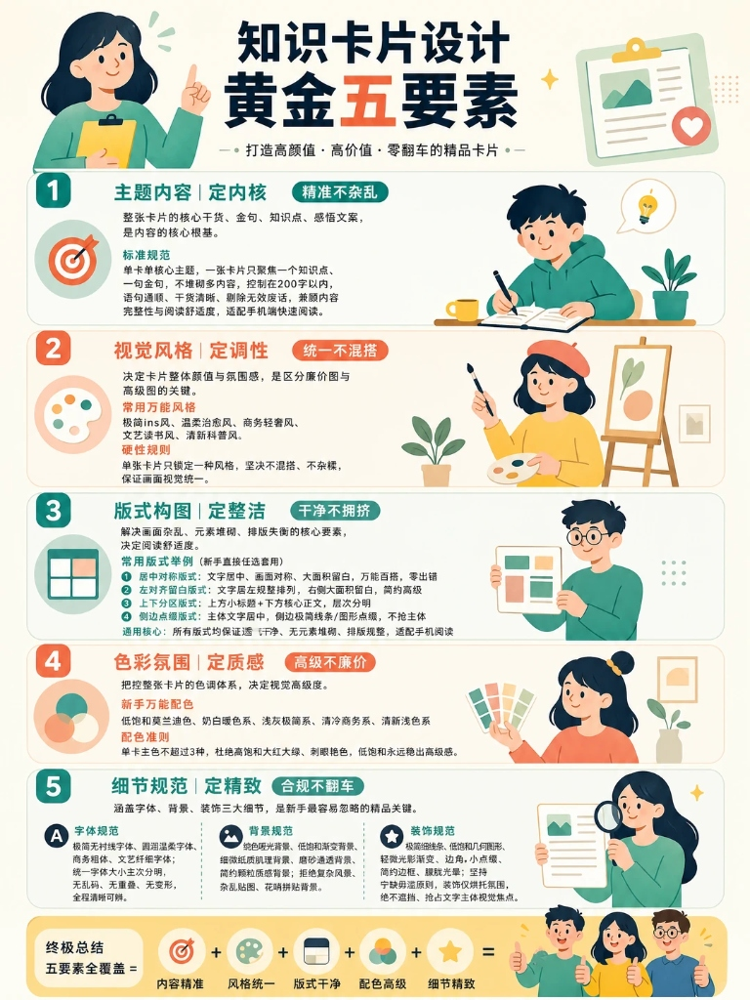

```
五要素全覆盖 ＝ 内容精准 ＋ 风格统一 ＋ 版式干净 ＋ 配色高级 ＋ 细节精致
```

### 1. 主题内容 | 定内核 (精准不杂乱)
* **单卡单核心**：一张卡片只聚焦一个核心知识点、一个方法或一句金句，绝不堆砌。
* **字数与信息密度按需适配**：多宫格碎片卡片注重手机端扫读与留白，剔除无效废话；单栏信纸/手写长文类按自然线性流排版，支持大篇幅连续书写。

### 2. 视觉风格 | 定调性 (统一不混搭)
* **风格绝对锁定**：单张卡片只锁定一种风格流派，坚决禁止“赛博朋克混搭水彩”这类杂糅。
* **五大万能风格收敛**：
  1. **极简 ins 风**（大留白、几何线条、现代感）
  2. **温柔治愈风**（彩泥、手账、暖色插画、萌宠）
  3. **商务轻奢风**（深蓝/黑金、低调微光、稳健拓扑）
  4. **文艺读书风**（蘸水笔排线、复古素描、焦糖淡彩）
  5. **清新科普风**（瑞士方格、清晰图解、扁平矢量）

### 3. 版式构图 | 定整洁 (灵动不僵化)
* **呼吸与透气**：不拘泥死板构图，根据内容自由舒展（可留白、可对称、可多宫格、可长信自然流动），核心是**不拥挤、不堆砌、层次分明**，给阅读留足视觉呼吸感。

### 4. 色彩氛围 | 定质感 (高级不杂乱)
* **色彩统合**：主色调保持克制协调（低饱和或同色阶统合），点缀色适度提神，杜绝互斥刺眼的原色打架，稳出高级质感。

### 5. 细节规范 | 定精致 (合规不翻车)
* **字体规范**：无衬线/圆润手写/商务粗体；大小主次层级分明，无乱码、无重叠、无变形。
* **背景规范**：纯色微光、低饱和渐变、细微纸质肌理；拒绝复杂实景、杂乱花哨拼贴。
* **平台发布参数硬性红线 (Platform Publishing Constraints)**：
  - **小红书 (Xiaohongshu)**：
    - ⚠️ **标题长度**：**硬性上限 20 字符**（含标点符号与 Emoji！超长直接弹窗阻断发布，建议精准卡在 16~19 字！）。
    - **正文长度**：上限 1000 字（最佳阅读体验 400~600 字）。
    - **轮播图片**：上限 9 张（严格遵循 3:4 比例，以 `p01`~`p09` 自然字母序保序）。
    - **话题标签**：末尾追加 4~6 个 `#标签`。
  - **知乎 / 掘金 / CSDN**：
    - 标题上限 100 字符，支持完整 Markdown，代码高亮与长文排版。

---

## 📝 Style 01: 学霸手绘手账知识地图规范

### 一、 核心视觉基因与排版铁律

1. **绝对纯净平整纸张**：
   * 采用柔和温暖的浅米白横线纸或方格纸底衬。
   * **绝对禁止**：金属活页环、打孔阴影、螺旋线圈、脏乱褶皱投影。
2. **深蓝圆角手绘大外框**：
   * 外围由一条饱满的深蓝色手绘圆角大框包裹，内部使用深蓝手绘线规整划分为 `2 列 × N 行`（常见为 2×3 或 2×4 共 6~8 个独立单元格）。
3. **原子化单元格结构 (Atomic Compartment)**：
   每个单元格必须统一遵循以下四层语法：
   * `[序号锚点]`：红色手绘双层同心圆圈（`01`, `02`...）。
   * `[模块标题]`：黑色工整手写字，下方带朱红色下划线。
   * `[图文互锁]`：左侧/上方为精致微简笔画（2D Flat Doodle），右侧/下方为 `定义:` 蓝色胶囊框 + 2~3 条要点列表。
4. **底部独立横幅收口**：
   * 底部横跨双列的长条手绘卡片，左侧配黄色手绘发光灯泡 💡，右侧为核心总结句，重点词汇带双层朱红下划线。

---

### 二、 通用提示词母版 (Prompt Template - 槽位化泛用版)

以后编写任意 AI 技术专题的网格手账图，直接套用此骨架填空：

```text
A super clean, authentic Japanese stationery style hand-drawn sketchnote knowledge poster, 2:3 vertical aspect ratio. 
The background is a flat, pristine warm cream-white paper with faint horizontal notebook lines, completely flat without any binder rings, spiral coils, or harsh shadows. 
Surrounding the entire content is a crisp, hand-drawn navy blue rounded border, cleanly divided inside by hand-drawn navy blue grid lines into exactly {GRID_COLS} columns and {GRID_ROWS} rows ({TOTAL_MODULES} organized rectangular compartments).

[HEADER SECTION]
Centered at the top above the grid:
Large bold handwritten title: `{MAIN_TITLE_BLACK}` in bold black ink, followed by `{MAIN_TITLE_RED}` in prominent crimson red bold hand-drawn brush lettering.
Directly beneath it, subtitle text in neat handwriting: `{SUBTITLE}`, flanked on both left and right sides by three hand-drawn blue radiant accent rays.

[COMPARTMENTS IN GRID]
{FOR EACH MODULE i}:
Row {r} Col {c} ({NUMBER_STR}): Top left shows a red hand-drawn double-circle badge with `{NUMBER_STR}`, followed by title `{MODULE_TITLE}` underlined with a red hand-drawn stroke. 
Inside a small blue rounded capsule box: `定义:` followed by `{DEFINITION}`. 
Accompanied by a clean doodle illustration of {DOODLE_DESCRIPTION}. 
Below are bullet points: {BULLET_POINTS}.

[FOOTER BANNER]
At the bottom spanning across both columns, a clean rounded horizontal card. On the far left, a bright yellow hand-drawn lightbulb doodle `💡`. 
In the center, prominent black and red handwritten text: `{FOOTER_TEXT_BLACK}` followed by `{FOOTER_TEXT_RED_HIGHLIGHT}` with two bold red underlines.

[ARTISTIC STYLE & CONSTRAINTS]
Crisp pen-and-paper illustration, cobalt blue hand-drawn ink outlines, warm crimson red badges and underlines, bright yellow accents, clean handwritten Chinese characters, spacious white margins, flat 2D vector sketchnote.
STRICT NEGATIVE: NO 3D rendering, NO glossy textures, NO shadows, NO hole punchers, NO binder rings, NO spiral notebook coils, NO blurry text, NO dirty stains, NO dark backgrounds.
```

---

### 三、 生产验证案例库

#### 案例 1：AI 基础 8 大核心概念 (8-Grid AI Map)
* **生产案例**：`sample-05-mimic-user-img1.png`（一图看懂 AI 的 8 个概念）

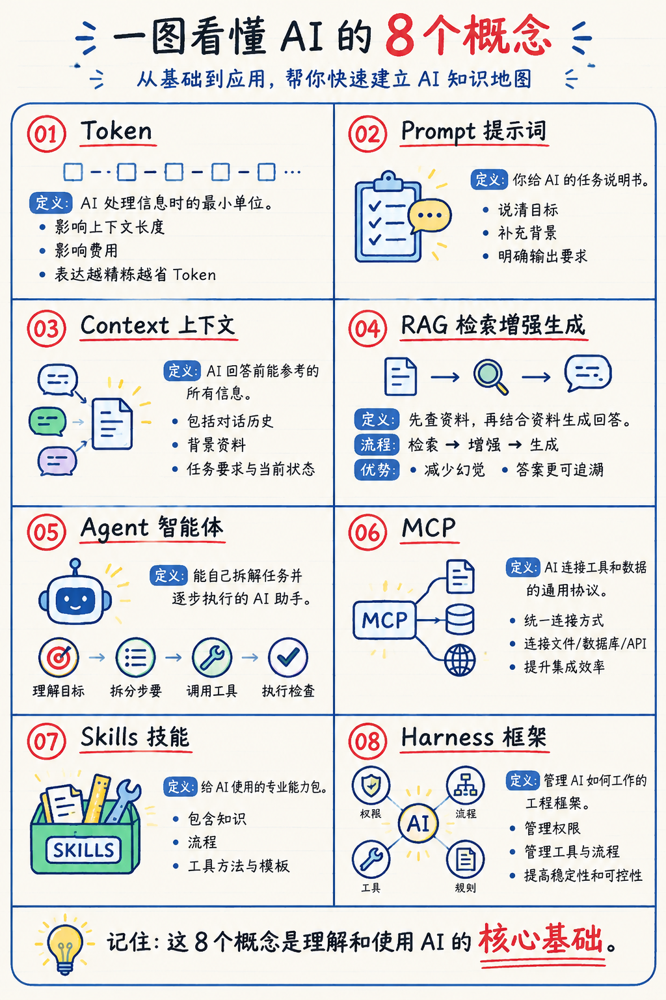
* **参数配置**：
  * 主标题：`一图看懂 AI 的` + `8 个概念`
  * 模块覆盖：01 Token, 02 Prompt 提示词, 03 Context 上下文, 04 RAG 检索增强生成, 05 Agent 智能体, 06 MCP, 07 Skills 技能, 08 Harness 框架。
  * 底部总结：`记住：这 8 个概念是理解和使用 AI 的` + `核心基础。`

---

## 📝 Style 02: 现代学院派方格手绘笔记规范 (Studygram Swiss Grid)

### 一、 核心视觉基因
* **底衬材质**：浅米绿/浅米灰 5mm 细方格纸，纯平无环，虚线水平分隔线切分三大板块。
* **排版骨架**：纵向三大板块，左侧文本条目（圆圈/方框序号 + 马克笔高亮），右侧对齐流程图/微架构/微缩卡片 + 细引线说明。
* **色彩系统**：三色半透明马克笔刷（草木绿、珊瑚粉、卡其棕），底部带斜贴胶带撕边便签小结。

### 二、 通用提示词母版 (槽位化泛用版)
```text
An authentic modern studygram notebook page, aesthetic swiss grid study notes poster, 2:3 vertical aspect ratio. 
The background is a clean, flat light cream-green 5mm grid graph paper texture, completely flat without any binder rings, spiral coils, or harsh shadows. Thin horizontal dashed divider lines cleanly separate the page into three major sections.

[TOP HEADER SECTION]
Bold handwritten title in dark ink: `{MAIN_TITLE_PREFIX}：{MAIN_TITLE_HIGHLIGHT}`, where the latter half `{MAIN_TITLE_HIGHLIGHT}` has a soft semi-transparent sage-green highlighter stroke beneath it.
Directly beneath it, neat subtitle: `{SUBTITLE} ✧`, followed by a thin dark green horizontal accent line.

[SECTION 1: {SEC1_TITLE}]
Section header box with a sage-green highlighter brush stroke: `一、{SEC1_TITLE}`.
- Left Column: Three bullet points with circular outline numbers ① ② ③ with pastel green highlights on key terms: {SEC1_BULLETS}.
- Right Column: Top timeline labeled `● 时间线: {TIMELINE_TITLE}`, nodes: {TIMELINE_NODES}. Bottom hand-drawn iPad tablet screen showing `{IPAD_SCREEN_NOTES}` with an `Apple Pencil` beside it.

[SECTION 2: {SEC2_TITLE}]
Section header box with a soft coral-pink highlighter brush stroke: `二、{SEC2_TITLE}`.
- Left Column: Four bullet points with square outline numbers 1 2 3 4: {SEC2_BULLETS}.
- Right Column: Diagram labeled `● {DIAGRAM_TITLE}`, showing flowchart cards with right-pointing callout arrows: {CALLOUT_ANNOTATIONS}.

[SECTION 3: {SEC3_TITLE}]
Section header box with a warm khaki-brown highlighter brush stroke: `三、{SEC3_TITLE}`.
- Left Column: Four bullet points with solid black circle numbers ❶ ❷ ❸ ❹: {SEC3_BULLETS}.
- Right Column: Top horizontal process flowchart: {PROCESS_FLOWCHART} ➔ glowing lightbulb `生产落地`. Bottom tilted sticky note taped with kraft washi tape, labeled `小结`, with 4 colored keyword blocks: {SUMMARY_KEYWORDS}, decorated with leaf doodles.

[ARTISTIC STYLE & CONSTRAINTS]
Crisp pen-and-paper illustration, authentic handwritten Chinese characters, soft pastel highlighter brush strokes, fine charcoal line art, spacious elegant layout.
STRICT NEGATIVE: NO 3D rendering, NO glossy textures, NO shadows, NO hole punchers, NO binder rings, NO spiral coils, NO blurry text, NO dirty stains, NO dark backgrounds.
```
* **生产案例**：`sample-07-mimic-user-img3.png`（大模型 Agent 认知架构设计与落地）

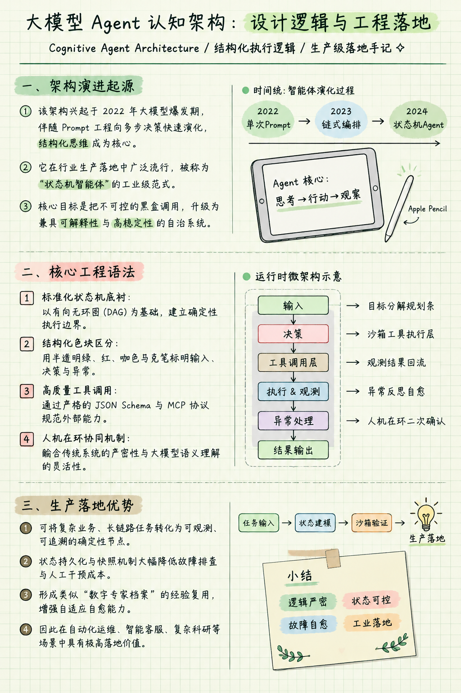

---

## 📝 Style 03: 极客活页草稿本手记规范 (Tech Geek Binder Guide)

### 一、 核心视觉基因
* **底衬材质**：淡蓝横线活页草稿本纸张，左侧规整打孔，纯正深海蓝与炭黑钢笔手绘线条。
* **排版骨架**：顶部双栏（指南定位+核心一句话破局）+ 中部 7 栏虚线核心能力微图标 + 中部进阶台阶流程（火柴人爬楼插旗）+ 底部复选框清单 + 底部 10 章节目录条。
* **角色点缀**：可爱的极简手绘火柴人（探头招手、爬台阶插旗、拿打勾板）。

### 二、 通用提示词母版 (槽位化泛用版)
```text
An ultra high-density authentic tech geek binder notebook guide poster, 2:3 vertical aspect ratio. 
The background is a clean, flat lined binder notebook paper with faint blue horizontal ruled lines and authentic hole punches along the left edge. Crisp dark navy blue and charcoal fountain pen ink lines, with subtle crimson red underline accents.

[TOP HEADER SECTION]
Large hand-drawn double-line title: `{MAIN_TOPIC}` flanked by radiant energy lines, followed by large bold brush lettering: `{GUIDE_TITLE}`. Framed with tiny botanical vine leaves.
Subtitle: `{SUBTITLE}`. Enclosed ribbon banner: `第 1 页 | 总览`.

[TOP ROW - TWO COMPARTMENTS]
Left: Rounded navy blue ink box with header `① 这篇指南讲什么？`, 4 bullet points: {AUDIENCE_BULLETS}. Lower-right corner has a cute minimal stick-figure peeking out and waving.
Right: Rounded navy blue ink box with star `⭐`, header `② 一句话先记住`, bold core mindset formula with red double underlines: `{CORE_MINDSET_FORMULA}`.

[MIDDLE ROW 1 - 7-COLUMN CORE CAPABILITIES]
Horizontal rounded container labeled `③ 核心能力`, 7 equal vertical columns divided by dashed lines, each with a circled number and doodle icon: {SEVEN_CAPABILITIES_LIST}.

[MIDDLE ROW 2 - LEARNING PATHWAY WITH STICK FIGURE]
Horizontal container labeled `④ 这套图你将学到`, 6 rectangular step cards connected by arrows: {PATHWAY_STEPS}. Right side has a doodle of a cheerful stick figure climbing a staircase towards a flag `🚩`.

[BOTTOM ROW - QUICK CHECKLIST]
Horizontal container labeled `⑤ 快速结论`, two parallel columns of checked boxes `☑️`: {CHECKLIST_ITEMS}. Lower-right corner has a stick figure holding a clipboard with speech bubble: `{STICK_FIGURE_QUOTE}`.

[FOOTER BANNER - TABLE OF CONTENTS]
Full-width ribbon strip labeled `本套目录`, followed by 10 numbered circular pill tags: {TEN_CHAPTERS}.

[ARTISTIC STYLE & CONSTRAINTS]
Crisp pen-and-paper illustration, authentic dark navy blue ink linework, charming handwritten Chinese characters, white and blue contrast, stick-figure illustrations.
STRICT NEGATIVE: NO 3D rendering, NO photorealistic objects, NO metallic textures, NO dark cyberpunk backgrounds, NO blurry handwriting, NO messy stains.
```
* **生产案例**：`sample-08-mimic-user-img4.png`（AI Agent 智能体架构完全上手指南）

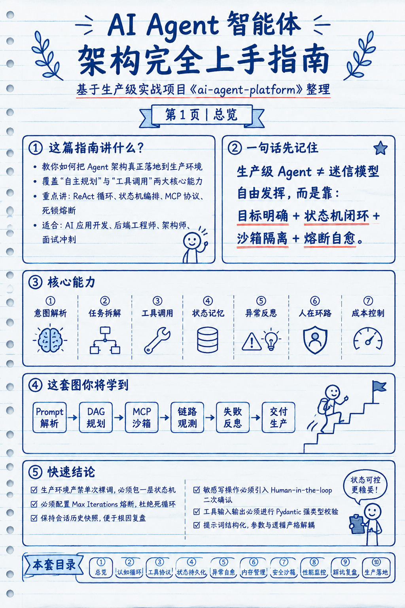

---

## 📝 Style 04: 线圈手账便签拼贴风规范 (Spiral Notebook Scrapbook)

### 一、 核心视觉基因
* **底衬材质**：左侧真实黑色金属双螺旋线圈环，平整温润浅米黄手账纸。
* **拼贴质感**：左上牛皮纸和纸胶带系列标签、右上淡蓝手写便利贴、彩色手绘小向日葵。
* **排版骨架**：大号序号 ❶ + 手写标题 + 橙色加粗重点词 + 手绘机器人吉祥物引线讲解 + 中部浅黄大卡片（7 行虚线微插画清单）+ 底部左下预告气泡与右下斜贴和纸胶带复选框便签。

### 二、 通用提示词母版 (槽位化泛用版)
```text
An ultra charming authentic spiral notebook scrapbook study poster, 2:3 vertical aspect ratio, aesthetic bullet journal and stationery collage style. 
The background is a clean, warm cream-yellow notebook page. Along the entire left edge is a neat row of authentic black metal double spiral binding coil rings piercing through clean punch holes.

[TOP AREA & SCRAPBOOK ELEMENTS]
Top-left: realistic semi-transparent kraft paper washi tape with handwritten text: `{SERIES_TITLE}` next to an orange star.
Top-right: tilted light-blue square sticky note pinned with tape: `{STICKY_NOTE_TEXT}`.

[MAIN TITLE & MASCOT]
Circled number `❶`. Large handwritten heading: `{HEADING_PREFIX}` followed by vibrant orange-brown brush handwritten title: `{HIGHLIGHT_TITLE}`.
Friendly conversational paragraph explaining the why: `{INTRO_PARAGRAPH}` (key term with yellow marker stroke).
Curved hand-drawn green arrow leads to a cute hand-drawn line-art robot mascot wearing antenna headphones, pointing upwards, stamped `(AI)`.

[CENTER BIG CARD - 7 ITEMS LIST]
Large rounded rectangular cream card with dashed border, green pill badge `例如:`.
7 neatly organized rows separated by fine dashed lines, each row: [{DOODLE_ICON}] `{ITEM_NAME_EN} ({ITEM_NAME_CN})` ➔ `{ITEM_DESCRIPTION}`.

[BOTTOM INTERACTION & CHECKLIST AREA]
Bottom-Left: Soft light-blue rounded speech bubble: `{TEASER_TEXT}` decorated with a colorful smiling sunflower doodle `🌻`.
Bottom-Right: Tilted warm-yellow square sticky note taped with green washi tape, containing 4 hand-drawn checkboxes `☑️`: {CHECKLIST_QUESTIONS}.

[ARTISTIC STYLE & CONSTRAINTS]
Crisp pen-and-paper illustration, authentic handwritten Chinese characters, authentic spiral coil binding, delicate washi tape textures, pastel markers, clean scrapbook aesthetic.
STRICT NEGATIVE: NO 3D photorealism, NO dark backgrounds, NO blurry handwriting, NO messy stains, NO distorted robot, NO unreadable overlapping text.
```
* **生产案例**：`sample-09-mimic-user-img5.png`（AI Agent 落地万能公式·核心工具协议）

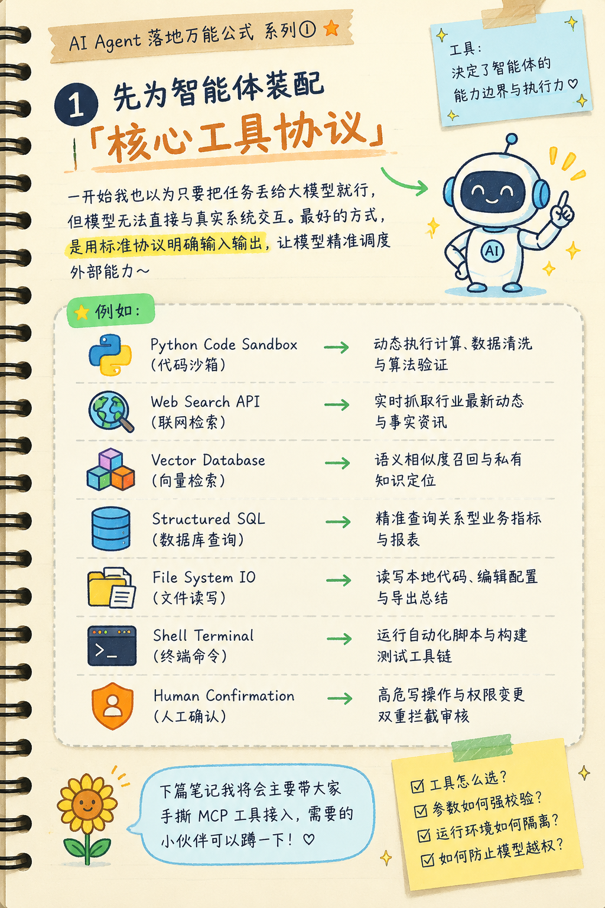

---

## 📝 Style 05: 可爱日漫少女手账指南规范 (Cute Anime Studygram Tutorial)

### 一、 核心视觉基因
* **底衬材质**：平整温润浅米黄方格纸，带柔和水彩粉/黄淡网格与小星星。
* **排版骨架**：顶部加粗彩色手绘大标题 + 丝带副标题横幅；主体由一条 S 型褐色小猫爪足迹将 5 个步骤卡片串联；底部左侧红白格子胶带《万能公式卡》+ 底部右侧牛皮胶带《小提醒便签》+ 软萌小白兔 🐰。
* **人物连续性**：长卷发日漫少女在 5 个步骤中呈现 5 种连贯情绪与动作（托腮沉思 ➔ 伏案做题 ➔ 数位板画图 ➔ 审视平板 ➔ 捧出成果）。

### 二、 通用提示词母版 (槽位化泛用版)
```text
An ultra charming and aesthetic cute anime girl studygram tutorial infographic poster, 2:3 vertical aspect ratio, pastel watercolor and Japanese stationery scrapbook style. 
The background is a clean, flat warm cream-white grid paper with faint pink and soft yellow grid lines, decorated with gentle pastel doodles, tiny colorful sparkles, and floating cute hearts.

[TOP HEADER SECTION]
Top-left corner has a soft red dashed cloud speech bubble with text `加油` next to a pink heart.
Large bold playful hand-drawn title in black and soft sage-green brush lettering:
`{TITLE_LINE_1}`
`{TITLE_LINE_2}`
Top-right corner shows a cute miniature pink notebook with a heart on the cover and a diagonal yellow pencil.
Directly beneath the title, a white rounded pill banner with pink hearts on both ends displays: `{BANNER_SUBTITLE}`.

[S-SHAPED 5-STEP PATHWAY WITH ANIME GIRL MASCOT]
A winding S-shaped pathway of delicate brown cat paw print dots links 5 sequential step cards, each featuring an expressive, cute anime girl with long wavy brown hair in different interactive study poses:
Step 1 (Top Left): Illustration of cute anime girl resting chin on hand over open notebook with glowing lightbulb `💡` above head. Card title: `① {STEP1_NAME}`. Text: `{STEP1_DESC}`. Tags: {STEP1_TAGS}.
Step 2 (Top Right): Illustration of anime girl wearing cozy lavender hoodie, diligently writing in a book. Card title: `② {STEP2_NAME}`. Text: `{STEP2_DESC}`. Tags: {STEP2_TAGS}.
Step 3 (Middle Left): Illustration of anime girl in pink sweater drawing on tablet with mini robot icon. Card title: `③ {STEP3_NAME}`. Text: `{STEP3_DESC}`. Tags: {STEP3_TAGS}.
Step 4 (Middle Right): Illustration of anime girl smiling at tablet screen with coffee mug. Card title: `④ {STEP4_NAME}`. Text: `{STEP4_DESC}`. Tags: {STEP4_TAGS}.
Step 5 (Lower Left): Illustration of anime girl smiling brightly holding up finished binder. Card title: `⑤ {STEP5_NAME}`. Text: `{STEP5_DESC}`. Tags: {STEP5_TAGS}.

[BOTTOM ROW - FORMULA & TIPS CARDS]
Left Card: Large cream card taped with red-and-white checkered washi tape, titled `万能公式 ⭐`. Pill chain equation: `{FORMULA_CHAIN}`. Example note: `💡 核心: {FORMULA_NOTE}`.
Right Card: Warm yellow sticky note taped with green washi tape, titled `小提醒 ♡`. List: {TIPS_ITEMS}. In the bottom-right corner, an adorable chibi white bunny doodle `🐰`.

[ARTISTIC STYLE & CONSTRAINTS]
Soft watercolor pastel illustration, charming anime girl characters, aesthetic studygram stationery, legible handwritten Chinese text, delicate dashed lines.
STRICT NEGATIVE: NO 3D rendering, NO photorealistic objects, NO metallic textures, NO dark cyberpunk backgrounds, NO blurry text, NO distorted faces, NO ugly anatomy, NO dirty stains.
```
* **生产案例**：`sample-10-mimic-user-img6.png`（怎么用 AI 打造高薪个人智能体）


---

## 📝 Style 06: 大厂生产架构全景图规范 (Enterprise Architecture Blueprint)

### 一、 核心视觉基因与防翻车铁律

1. **绝对纯白底 2D 矢量平面制图 (Vector Flat)**：
   * 背景为纯白无渐变底（`#FFFFFF`），彻底拒绝 3D 渲染、玻璃反光、脏乱纸纹与发灰投影。
   * 线条均为 1~2px 锐利深蓝/深灰色工业级实线与圆角矩形，对齐严格。
2. **三栏翼展工业拓扑 (Tri-Column Winged Layout)**：
   * **左翼 (15% 宽度)**：**安全与治理**（深蓝顶栏 + 盾牌 Icon + 纵向单列 8 个治理模块）。
   * **中枢 (70% 宽度)**：**核心架构堆栈**（纵向 6 层，从上到下：接入层 ➔ 业务层 ➔ 编排中枢 ➔ 模型层 ➔ 知识层 ➔ 基础设施层）。
   * **右翼 (15% 宽度)**：**观测、评测与运营**（深蓝顶栏 + 仪表盘 Icon + 纵向单列 8 个运营模块）。
   * **底部 (100% 满宽)**：**企业级非功能特性基石**（深蓝横幅 + 8 个标准核心指标横排 + 底部数据流/控制流图例说明）。
3. **消除乱码与文字粘连的排版三原则**：
   * **容器内字符安全极限**：横向单行并排卡片数量**绝对不能超过 5~6 个**。每个卡片必须是单层纯白底，字数严格控制在 4~6 字以内。
   * **彻底禁用复杂多层套娃**：严禁在小卡片内部再切上下子抽屉！坚决采用单层平面圆角卡片，文字居中大号加粗。
   * **色彩统一与高对比铁律**：严禁在冷色系图纸中突兀插入紫色（紫色解码极易引起字符粘连乱码）。核心中枢统一采用**浅冰蓝大底（Ice Blue `#EBF3FC`）+ 纯平无渐变白底卡片（Pure White `#FFFFFF`）+ 深蓝/黑体字（Navy/Black `#0F172A`）**，对比度拉满！

---

### 二、 通用提示词母版 (Prompt Template - 槽位化泛用版)

以后编写任意生产级系统架构图、全景大图，直接套用此骨架填空：

```text
An ultra high-density, authoritative enterprise-grade AI software system architecture blueprint poster, 2:3 vertical aspect ratio, pristine 2D vector flat diagram style. 
The background is pure crisp white (#FFFFFF) without any paper textures, shadows, or gradients. The overall layout features a majestic Tri-Column Winged Architecture: Left Security Pillar (15% width), Central Core Architecture Stack (70% width), Right Observability Pillar (15% width), and a Full-Width Non-Functional Foundation Strip at the bottom. Color palette strictly unified: Royal Navy Blue (#1E40AF), Ice Blue (#EBF3FC), Tech Cyan (#0284C7), and Pure White (#FFFFFF). STRICTLY NO PURPLE OR VIOLET.

[TOP HEADER SECTION]
Large bold royal navy blue title in crisp modern sans-serif: `{SYSTEM_TITLE}`.
Subtitle below: `{SYSTEM_SUBTITLE}`.

[LEFT WING - {LEFT_WING_TITLE} (15% width)]
Enclosed in a slim vertical container with a solid royal blue header card: `{LEFT_WING_TITLE}`, shield icon.
Vertically stacked 8 neat rectangular pure white cards with micro vector outline icons:
{LEFT_WING_ITEMS_LIST}

[RIGHT WING - {RIGHT_WING_TITLE} (15% width)]
Enclosed in a slim vertical container with a solid royal blue header card: `{RIGHT_WING_TITLE}`, chart dashboard icon.
Vertically stacked 8 neat rectangular pure white cards with micro vector outline icons:
{RIGHT_WING_ITEMS_LIST}

[CENTER CORE ARCHITECTURE STACK (70% width) - 6 TIERS]
Tier 1 (Top): `1. {TIER1_NAME}` (Navy card). Horizontal row of {TIER1_ITEMS_COUNT} pure white cards: {TIER1_ITEMS}.
Tier 2: `2. {TIER2_NAME}`. Horizontal row of {TIER2_ITEMS_COUNT} pure white cards: {TIER2_ITEMS}.
Tier 3 (PROMINENT HIGHLIGHT - AGENT RUNTIME CORE - ICE BLUE & PURE WHITE THEME):
A highlighted Soft Ice Blue container with bold navy header badge: `3. {TIER3_NAME}`.
ALL CARDS INSIDE ARE PURE FLAT WHITE WITH CRISP BOLD BLACK/NAVY TEXT.
Row 1 (Environment & Context): 4 horizontal pure white cards: {TIER3_ROW1_ITEMS}
Row 2 (Sequential Workflow Pipeline): Exactly 5~6 wide pure white cards linked by horizontal navy blue arrows:
{TIER3_WORKFLOW_STEPS}
Row 3 (Core Engines): 3 wide pure white capability cards:
{TIER3_ENGINES_3}
Tier 4: `4. {TIER4_NAME}`. 3 wide pure white panels: {TIER4_PANELS}.
Tier 5: `5. {TIER5_NAME}`. Pure white cards: {TIER5_CARDS}.
Tier 6 (Bottom Core): `6. {TIER6_NAME}`. Pure white cards: {TIER6_CARDS}.

[BOTTOM FOUNDATION STRIP - 7. 企业级非功能特性]
A full-width horizontal navy blue strip with white badge: `7. 企业级非功能特性`, followed by 8 outline icon cards:
`可扩展` | `高可用` | `低延迟` | `可观测` | `安全合规` | `可审计` | `可运营` | `可迭代`.
Beneath it, clean legend with 3 colored arrow lines: `数据流向 (深蓝实线)`, `控制流向 (蓝虚线)`, `反馈优化 (青色虚线)`.

[ARTISTIC STYLE & CONSTRAINTS]
Ultra clean 2D vector flat enterprise software architecture, pristine razor-sharp lines, crisp legible Chinese characters, vibrant royal navy blue, cyan and ice-blue accents, pure flat white cards with bold dark navy text, perfect container alignments, zero clutter, spacious typography.
STRICT NEGATIVE: NO purple, NO violet, NO lavender, NO 3D rendering, NO photorealistic objects, NO metallic textures, NO hand-drawn sketch style, NO binder rings, NO paper textures, NO dark backgrounds, NO blurry text, NO background overlap, NO messy gradients, NO alien gibberish symbols, NO distorted Chinese characters.
```

---

### 三、 生产验证案例库

#### 案例 1：AI Agent 生产级架构全景图 (6-Tier End-to-End Blueprint)
* **生产案例**：`sample-13-mimic-enterprise-arch-iceblue.png`（AI Agent 生产级架构全景图）

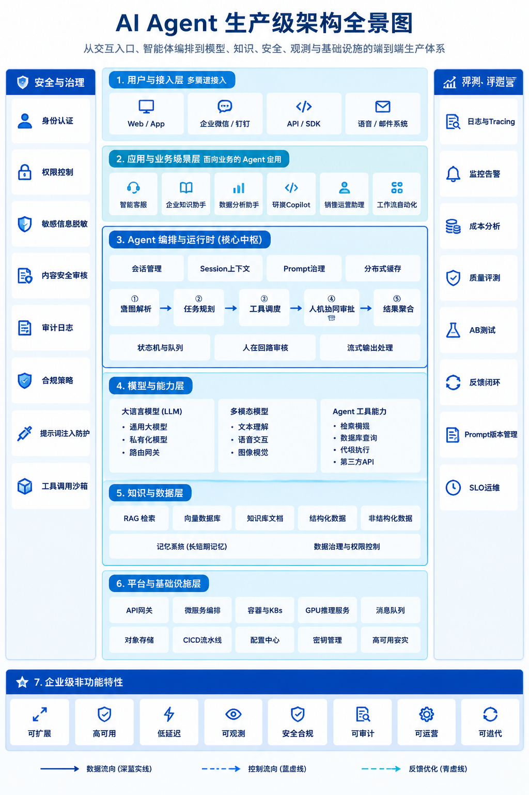
* **参数配置**：
  * 主标题：`AI Agent 生产级架构全景图`
  * 副标题：`从交互入口、智能体编排到模型、知识、安全、观测与基础设施的端到端生产体系`
  * 关键突破：彻底废除紫色背景，全面重构为**浅冰蓝大底 + 纯平白底黑字卡片**；工作流精简为 5 个大字号单层白卡，汉字清晰锐利，零乱码、零套娃！

---

## 📝 Style 07: 全景自检互动式架构栈规范 (Interactive Diagnostic Architecture Stack)

### 一、 核心视觉基因与排版铁律

1. **垂直多层诊断架构**：
   * 从上到下清晰排布 7 大层级：输入感知 ➔ ReAct 核心运行（持续迭代闭环 + 状态胶囊） ➔ LLM 智能大脑 ➔ 核心三柱（技能 / 工具 / 环境） ➔ 记忆知识 ➔ 基础设施 ➔ 8 步端到端业务流。
2. **痛点警示胶囊与自检刺痛 (Diagnostic Badges)**：
   * 标题旁带自检标语：`⚠️ 对照自检：你搭了几层？`。
   * 关键薄弱层（工具集成、记忆知识）注入高对比珊瑚红警告徽章：`⚠️ 多数企业缺失`、`⚠️ 大多数企业得0分`。
3. **底部双色高反差行动呼吁条 (Call-to-Action Footer)**：
   * 左黑底白字：`你的企业搭建了几层？`
   * 右亮橙底黑字加粗：`层数越少，被替代风险越高 — 评论区告诉我 ➔`。
   * 极具社媒点击率与评论区引流效应。

### 二、 通用提示词母版
* **模板 ID**：`diagnostic-architecture-stack`
* **生产案例**：`sample-14-diagnostic-architecture-stack.png`（企业级 AI Agent 架构自检全景图）

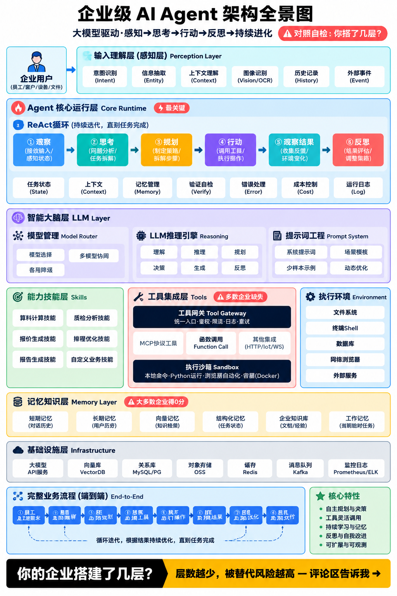

---

## 📝 Style 08: 单列流式五层技能流水线规范 (5-Tier Linear Skills Pipeline)

### 一、 核心视觉基因与排版铁律

1. **单列极简纵向 5 步流水线**：
   * 严格按数据与控制流顺序纵向排列：
     - `第一层：用户交互层 (User Interaction Layer)`
     - `第二层：智能规划层 (Agent Reasoning Layer)`
     - `第三层：技能执行层 (Skills Execution Layer)`
     - `第四层：反馈与记忆层 (Memory & Feedback)`
     - `第五层：最终输出层 (Result Layer)`
2. **标杆序号徽章系统**：
   * 每一层左上角统一使用带浅灰圆角矩形包裹的白色数字徽章（`1`, `2`, `3`, `4`, `5`），下附一句话功能说明。
3. **2×4 技能库矩阵与闭环双向箭头**：
   * 第三层展示 8 大核心技能（联网、代码、分析、创作、浏览器、文件、SQL、API），统一搭配蓝色矢量线性图标。
   * 第四层展示 `Observation 🔄 Skill History 🔄 Prompt Update` 双向循环箭头，强化智能体自我进化机制。

### 二、 通用提示词母版
* **模板 ID**：`linear-skills-pipeline`
* **生产案例**：`sample-15-linear-skills-pipeline.png`（AI Agent Skills 技术架构全景图）

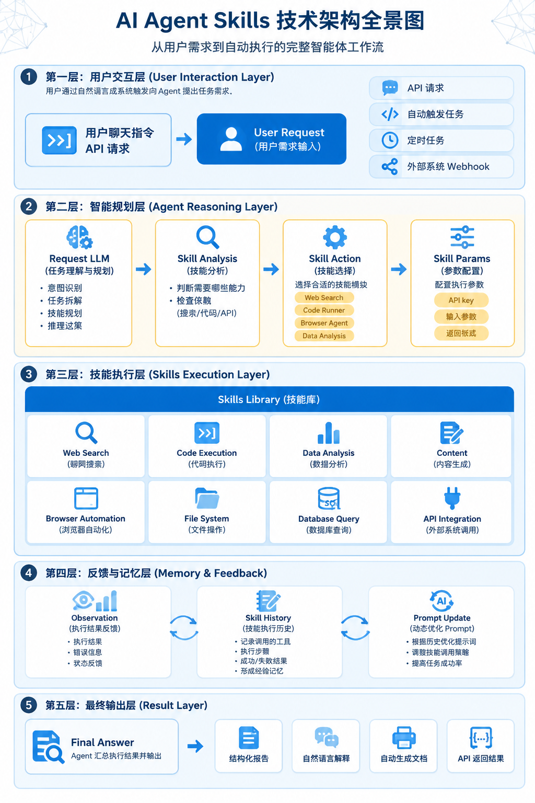

---

## 📝 Style 09: 治愈系彩泥定格手账指南规范 (Claymation Plasticine Studygram)

### 一、 核心视觉基因与排版铁律

1. **纯手工捏制黏土/软陶泥定格动画质感 (Polymer Clay & Plasticine)**：
   * 画面所有元素（外边框、标题文字、小熊/小兔吉祥物、卡片、多肉盆栽、图标）全部呈现真实的彩泥手捏质感。
   * 表面带微微的手工捏痕与漫反射泥纹，彻底杜绝冰冷的 3D 镜面反光或单调的 2D 矢量线。
2. **统一吉祥物叙事系统 (Brand Mascots)**：
   * **棕色小熊 🐻**：负责封面探头迎宾、正文表情包对比（流汗哭泣错误熊 ➔ 开心大笑正确熊）、伏案学习专注熊。
   * **魔法小白兔 🐰**：负责卡片底部指引与小贴士口播。
3. **套图连贯性设计 (Carousel Consistency)**：
   * **P1 封面 + 玩法 1**：大标题泥塑雕刻 + 痛点导语卡 + 第 1 个玩法（三档盾牌对比）。
   * **P2 正文连贯页**：每个玩法对应一个独立圆角泥塑大卡片（带数字徽章 `2`, `3`...），内含生动对比与工作流。

### 二、 通用提示词母版
* **模板 ID**：`claymation-studygram-guide`
* **生产案例**：
  - **P1 封面**：`sample-16-claymation-p1-cover-v2.png`

    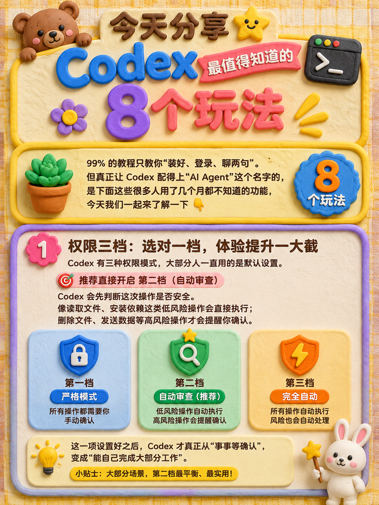

  - **P2 正文**：`sample-17-claymation-p2-content-v2.png`

    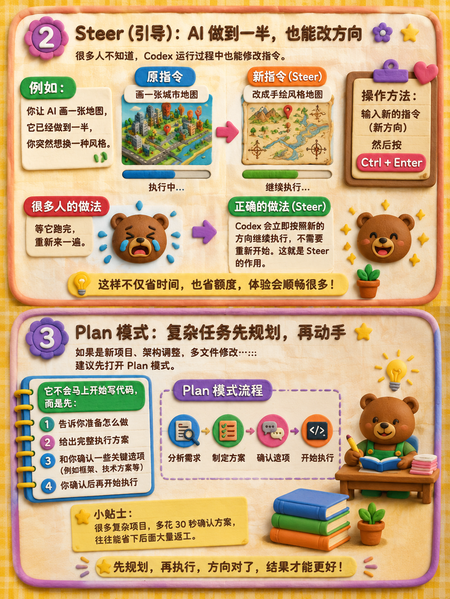

---

## 📝 Style 10: 复古线圈素描学霸手记规范 (Vintage Spiral Sketchbook Studygram)

### 一、 核心视觉基因与排版铁律

1. **真实物理螺旋装订与复古草稿纸**：
   * 左侧边缘严格保留真实的金属双螺旋线圈装订与矩形打孔排线。
   * 底衬为温暖泛黄、带细腻纤维肌理的复古水彩草稿纸（Warm Aged Kraft Paper）。
2. **黑墨水细钢笔素描排线 + 焦糖淡彩 (Dip-Pen & Sepia Wash)**：
   * 所有物体（闹钟、书堆、多肉、路标、日历、奖杯、伏案少女）均由极其精致的黑水笔蘸水笔素描勾勒，带有细腻的手绘交叉排线阴影（Cross-Hatching）。
   * 标题、时间轴胶囊、重点小标签带有柔和温润的焦糖暖黄水彩笔刷底衬（Sepia Watercolor Wash），绝非单调黑白。
3. **高密度左右双栏与时间轴排版**：
   * 中间 4 列手绘虚线小卡片并排。
   * 下半部分采用 50% 核心方法列表 + 50% 8 阶段高效日程表时间轴双栏对称。
   * 底部右侧配有沉静专注的伏案做题素描少女、书堆与笔筒，极具人文温度与学术自律感。

### 二、 通用提示词母版
* **模板 ID**：`vintage-sketchbook-studygram`
* **生产案例**：`sample-18-vintage-sketchbook-studygram.png`（拒绝拖延！暑期弯道超车学习法）


---

## 📝 Style 11: 萌系马卡龙手账清单规范 (Kawaii Pastel Planner Checklist)

### 一、 核心视觉基因与排版铁律

1. **温润米白方格纸手账与活页金属孔**：
   * 背景为温暖米白色（Off-white Cream）方格底纸，左侧边缘严格带有活页本（Spiral Binder）金属冲压打孔。
   * 四角点缀马卡龙色系和纸胶带（左上淡蓝格纹、右上薄荷绿格纹）与软萌草莓、花朵贴纸。
2. **圆润 3D 泡泡大字 + 缝线飘带副标**：
   * 顶部主标题采用浓郁巧克力棕色底、带加厚奶油白描边与柔和投影的 3D 萌系泡泡体（如：`断舍离超全清单`）。
   * 副标题置于圆角粉色虚线缝线飘带徽章内（如：`照着扔就对了`）。
   * 左右分列趴着探头的腮红小熊与捧心小白兔吉祥物。
3. **2x4 共 8 宫格色彩矩阵卡片**：
   * 8 个独立圆角大色块卡片（粉红、粉蓝、抹茶绿、薰衣草紫、蜜桃橙、珊瑚粉、冰蓝、鼠尾草绿）。
   * 每个卡片顶部配备对应色系的胶囊标题栏与可爱小 Icon（如衣架、香水瓶、煮锅、肥皂、小药箱、蝴蝶结、小房子、嫩叶）。
   * 紧凑清晰的彩色圆点清单条目，搭配右侧极具生活气息的手绘小插画（挂衣架、双层亚克力化妆架、空气炸锅与锅碗瓢盆、洗漱台、棕色药瓶与胶囊、书堆与小熊玩偶、石膏像与多肉盆栽、下雨乌云与手账本手机）。

### 二、 通用提示词母版
* **模板 ID**：`kawaii-planner-checklist`
* **生产案例**：`sample-19-kawaii-planner-declutter-checklist.png`（断舍离超全清单：照着扔就对了）


---

## 📝 Style 12: 工坊极客小机器人手账卡规范 (Geek Workshop Robot Sketchnote)

### 一、 核心视觉基因与排版铁律

1. **博客长文 16:9 横版宽屏视口（`1536x864`）**：
   * 专为掘金、知乎、CSDN 与公众号等技术长文量身打造。
   * 彻底告别竖版撑破浏览器单屏的痛点，一行 3 大核心卡片水平排开，高密度吸收。
2. **IP 伴侣协同叙事（悬浮小机器人划重点）**：
   * 右上方悬浮白蓝极客小机器人（与作者头像 1:1 呼应），戴耳机天线，发光弯眼笑脸，探出手指或拉出蓝色手绘弧形引线指向重点。
   * 自带蓝色圆角气泡对话框（如：`小助手划重点：绝不轻信口头承诺，只认测试通过！`）。
3. **品牌胶带印章（左上角工坊标识）**：
   * 左上角贴有半透明牛皮纸质感胶带，手写文字：`佳欣的AI工坊 ✧ @ljxpython`。
4. **色彩体系与作者连帽衫同频**：
   * 采用深海蓝（Navy Blue `#1E293B`）手绘粗圆角外框。
   * 内部为浅米白温暖横线纸底衬（`#FDFBF7`），纯白卡片托底，搭配天蓝（Tech Sky Blue `#38BDF8`）、活力暖橙与鲜亮朱红重点标注。
5. **底部横幅架构真理收口**：
   * 底部横跨满宽的长条手绘卡片，左侧黄色手绘发光灯泡 💡，右侧为核心架构哲学金句，重点词汇带双层朱红下划线。

---

### 二、 通用提示词母版 (Prompt Template - 槽位化泛用版)

```text
An ultra charming, authentic Japanese stationery style geek workshop sketchnote knowledge card, horizontal 16:9 aspect ratio (1536x864).
[ARTISTIC STYLE & PALETTE]
Warm cream-white stationery notebook paper background with very faint horizontal ruled lines. Crisp hand-drawn dark navy blue ink linework (#1E293B), tech sky-blue highlights (#38BDF8), vibrant orange accent brush strokes, and pure white cards. The visual aesthetic directly matches the 'Geek Workshop Desk' anime style with warm studio atmosphere.
Enclosed in thick hand-drawn dark navy blue rounded rectangle border.

[TOP-LEFT BRANDING]
Semi-transparent washi tape in top-left: `佳欣的AI工坊 ✧ @ljxpython`.

[TOP HEADER]
Header in bold dark navy ink: `{MAIN_TITLE}` with orange brush highlight stroke behind key words.
Subtitle in neat hand-lettering: `{SUBTITLE}`.

[CENTER GRID: 3 EQUAL ROUNDED CARDS]
The middle area is divided into 3 spacious pure white rounded cards with fine dark navy outlines:
- Card 1 (Left): Red circular badge `①`, bold title `{CARD1_TITLE}`. {CARD1_DOODLE_DESC}. Bullet points: {CARD1_BULLETS}.
- Card 2 (Center): Blue circular badge `②`, bold title `{CARD2_TITLE}`. {CARD2_DOODLE_DESC}. Bullet points: {CARD2_BULLETS}.
- Card 3 (Right): Green circular badge `③`, bold title `{CARD3_TITLE}`. {CARD3_DOODLE_DESC}. Bullet points: {CARD3_BULLETS}.

[MASCOT ANNOTATION - FLOATING MINI AI ROBOT]
Floating above the right side of the cards is an adorable miniature white-and-sky-blue AI robot assistant with cute headphone antennae and smiling glowing cyan LED curved eyes. It points a hand-drawn arrow toward Card 3 with a light-blue speech bubble: `{ROBOT_SPEECH_BUBBLE}`.

[BOTTOM FOOTER BANNER]
At the bottom spanning the full width, a clean rounded horizontal bar. On the left, a bright yellow glowing hand-drawn lightbulb `💡`. In the center, prominent handwritten text: `{FOOTER_CORE_TRUTH}` with red double underlines under `{KEY_PHRASE}`.

[CONSTRAINTS & NEGATIVES]
100% pure simplified Chinese text, razor sharp legible handwriting, high contrast, clean spacious margins, charming geek workshop vibe.
STRICT NEGATIVE: NO English gibberish, NO messy garbled letters, NO 3D metallic textures, NO dark cyberpunk backgrounds, NO blur, NO distorted robot anatomy.
```

---

### 三、 生产验证案例库

#### 案例 1：AI Harness 生产落地万能公式 (3-Card Horizontal Sketchnote)
* **生产案例**：`assets/images/sample-geek-robot-workshop-card.png`

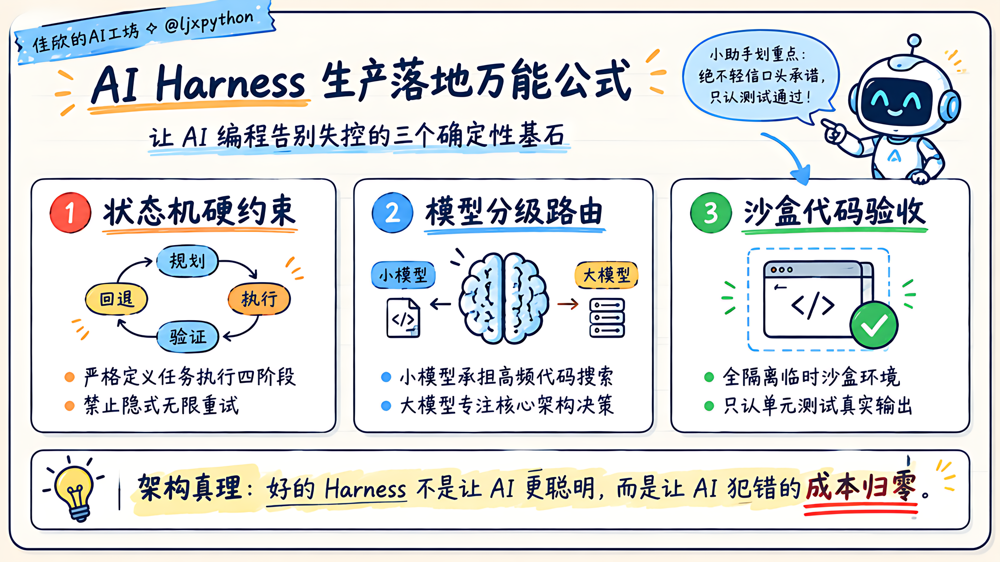

* **参数配置**：
  * 标题：`AI Harness 生产落地万能公式` | 副标：`让 AI 编程告别失控的三个确定性基石`
  * 模块 1：`状态机硬约束`（四阶段闭环、禁止隐式重试）
  * 模块 2：`模型分级路由`（小模型搜索、大模型决策）
  * 模块 3：`沙盒代码验收`（隔离环境、只认单元测试真实输出）
  * 机器人划重点：`小助手划重点：绝不轻信口头承诺，只认测试通过！`
  * 底部总结：`架构真理：好的 Harness 不是让 AI 更聪明，而是让 AI 犯错的成本归零。`

---


## 📂 视觉参考图索引 (Style References)

用户提供的标准参考样本已永久归档至 `assets/images/style-references/`：

1. **`ref-01-sketchnote-8-concepts.jpg`**：手绘手账知识地图（8 宫格规范标杆）

   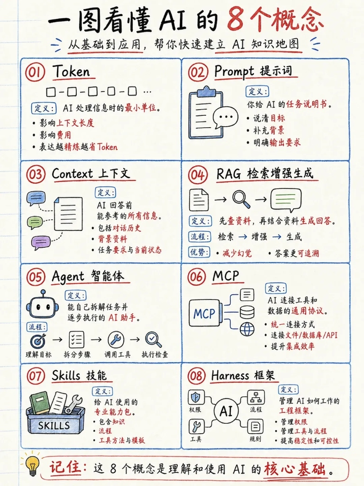

2. **`ref-02-system-architecture-xinyuan.png`**：工业级高密度系统全景蓝图

   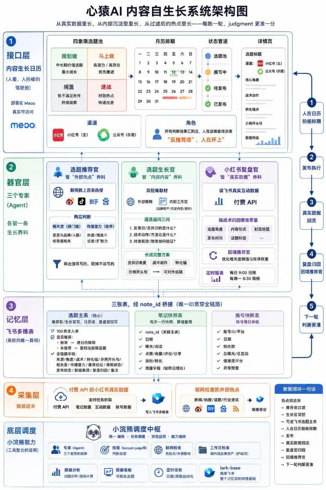

3. **`ref-03-studygram-swiss-grid.jpg`**：现代学院派方格手绘笔记

   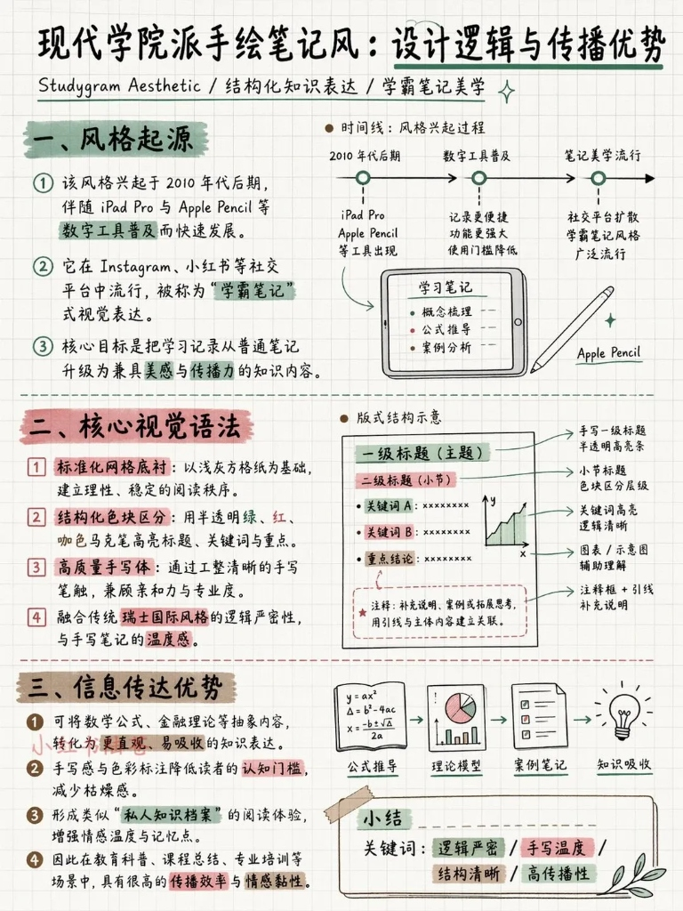

4. **`ref-04-binder-notebook-guide.jpg`**：极客活页草稿本手记

   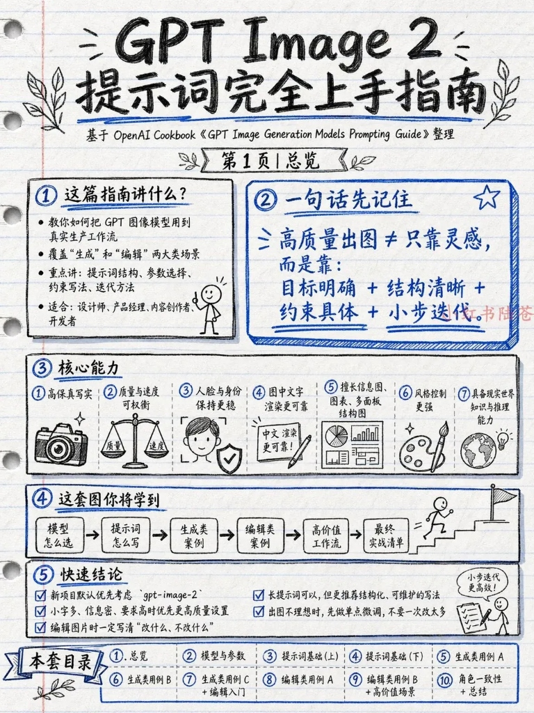

5. **`ref-05-spiral-notebook-scrapbook.jpg`**：线圈手账便签拼贴风

   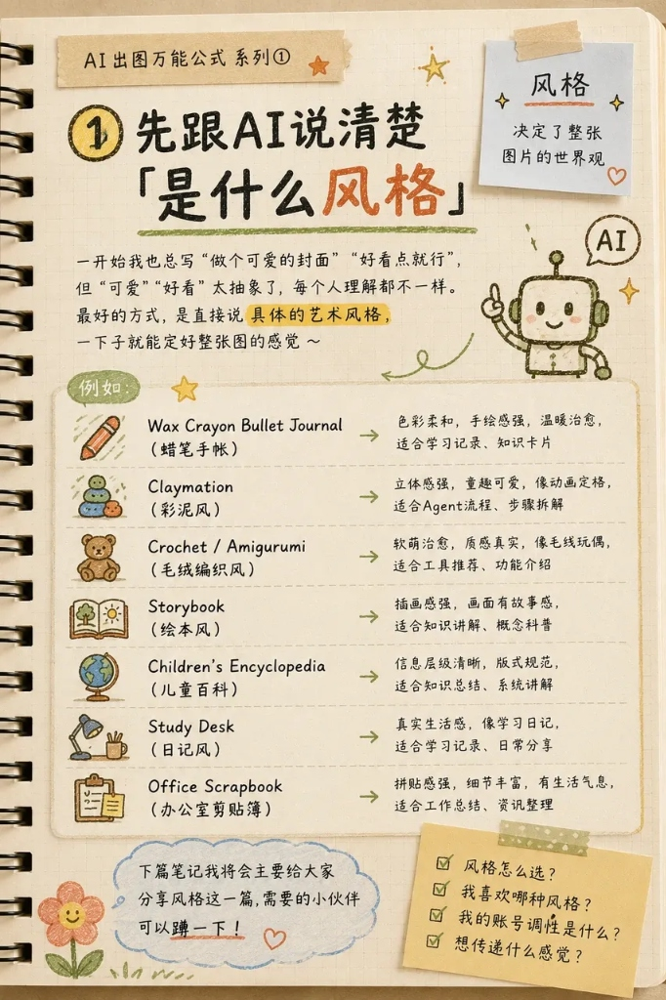

6. **`ref-06-cute-anime-sketchnote-guide.jpg`**：可爱日漫少女手账笔记风（5步步骤指南）

   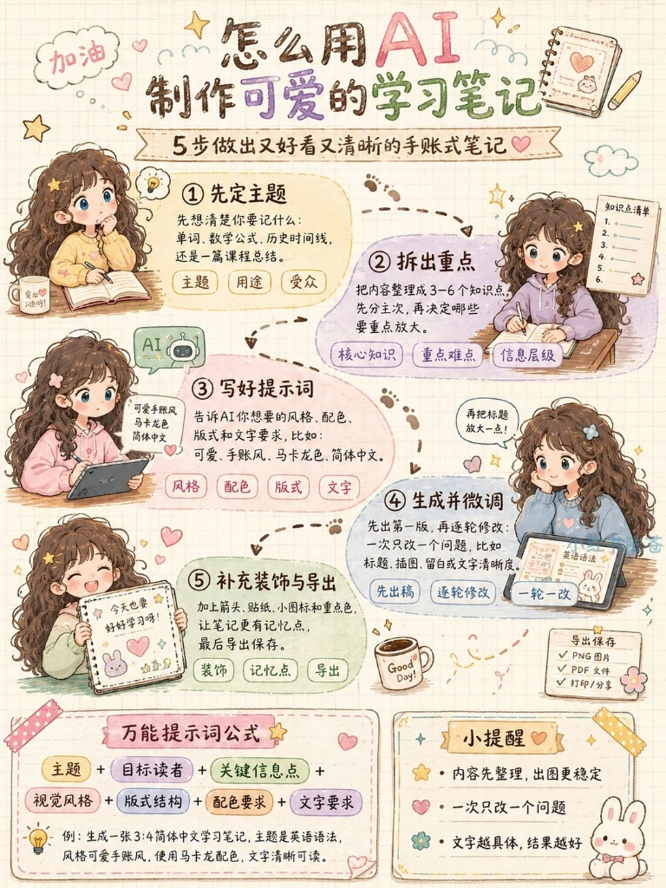

7. **`ref-07-enterprise-agent-production-arch.jpg`**：企业级生产架构全景图（左右双翼支撑 + 中间6层核心堆栈）

   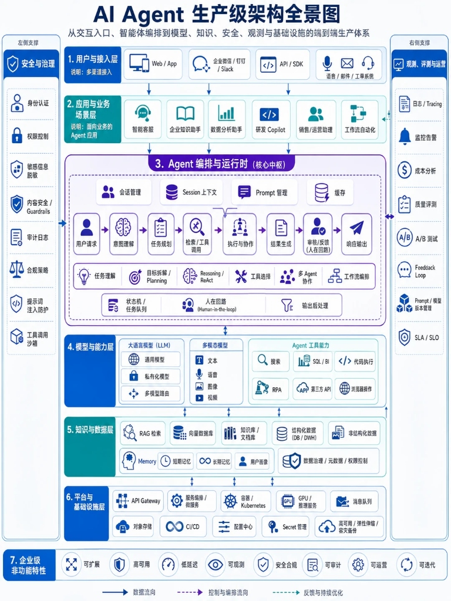

8. **`ref-08-enterprise-agent-interactive-stack.jpg`**：全景自检互动式架构栈（痛点警示胶囊 + 底部评论互动条）

   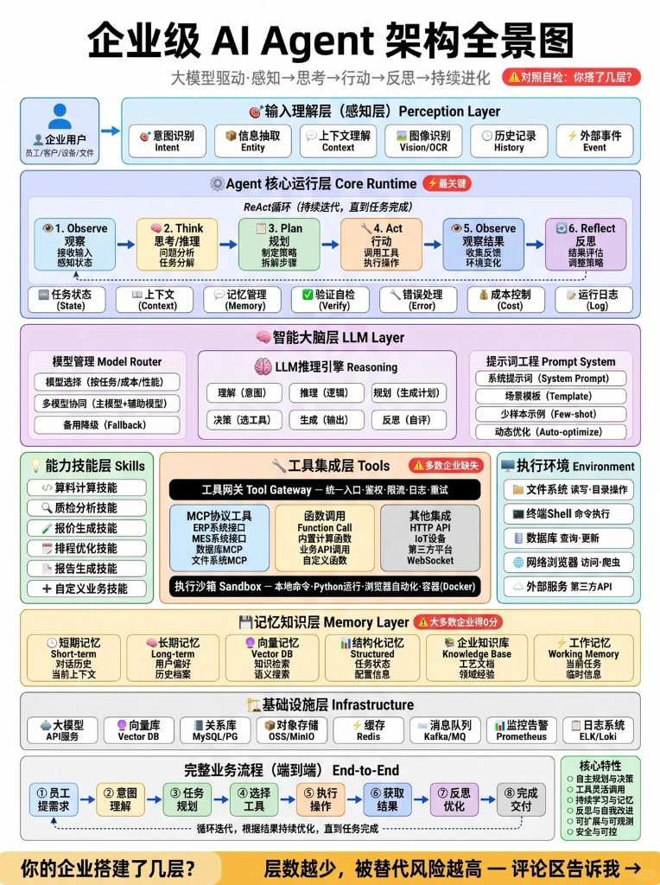

9. **`ref-09-agent-skills-pipeline-flow.png`**：单列流式五层技能流水线（5 步线性递进 + 2×4 技能库矩阵）

   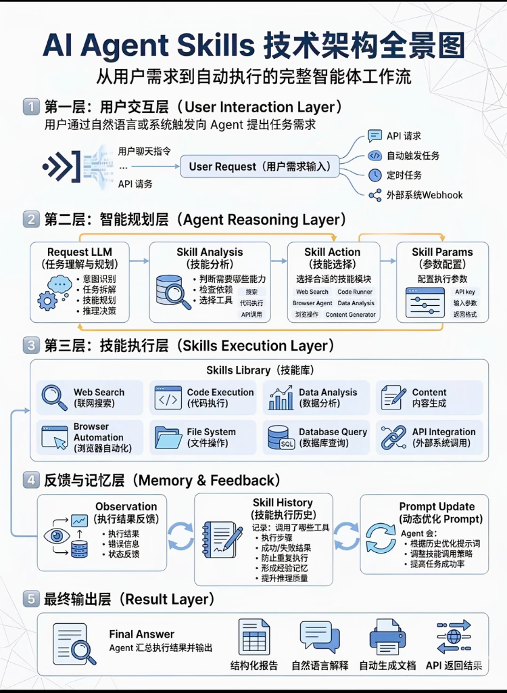

10. **`ref-10-claymation-studygram-p1.jpg`**：治愈系彩泥手账套图 P1 封面（小熊探头 + 玩法 1 权限三档）

    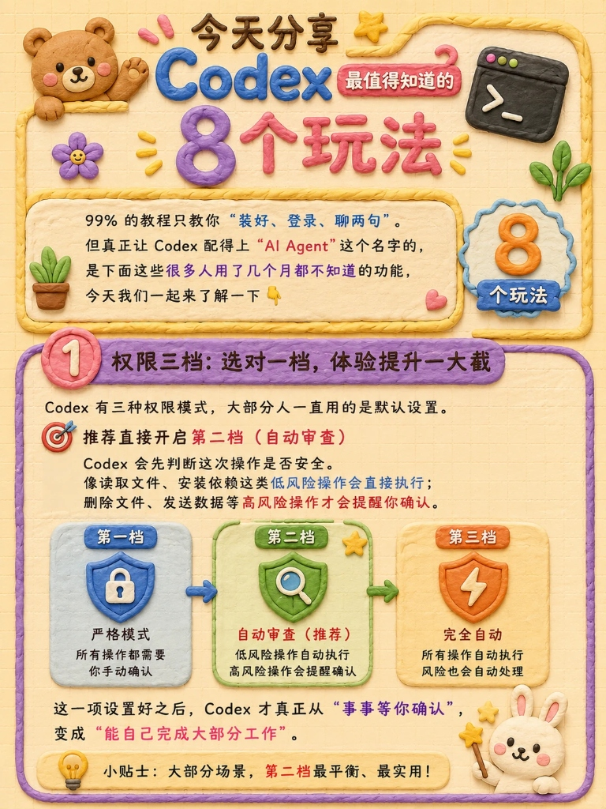

11. **`ref-11-claymation-studygram-p2.jpg`**：治愈系彩泥手账套图 P2 正文（玩法 2 引导修改 + 玩法 3 Plan 规划模式）

    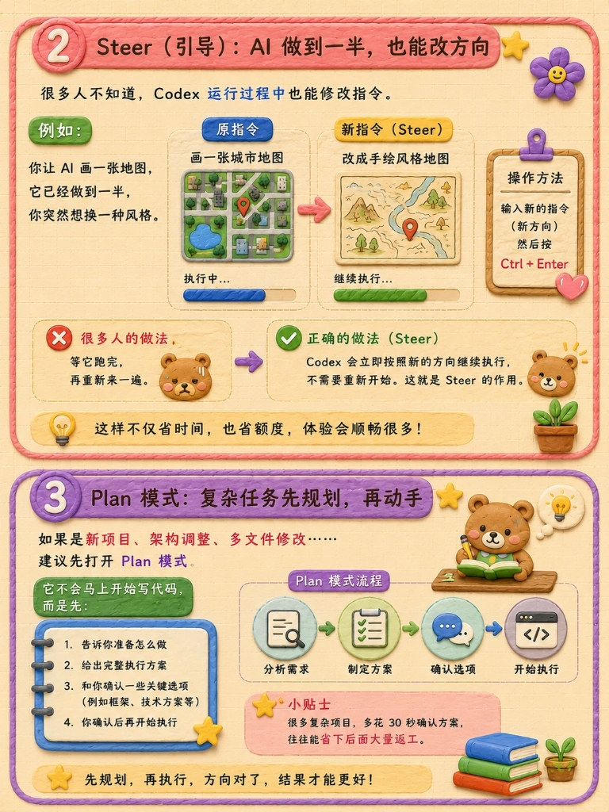

12. **`ref-12-vintage-spiral-girl-studygram.jpg`**：复古线圈素描学霸手记（左金属线圈 + 精细黑墨水笔素描 + 焦糖淡彩 + 伏案少女）

    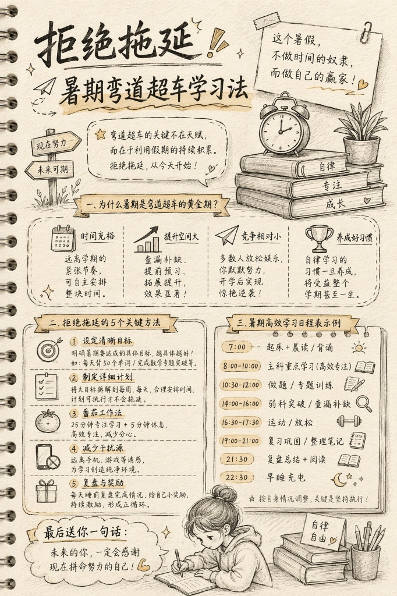

13. **`ref-13-declutter-checklist-studygram.jpg`**：萌系马卡龙手账清单（米白方格纸 + 2x4 共8宫格马卡龙卡片 + 萌系小熊白兔贴纸）

    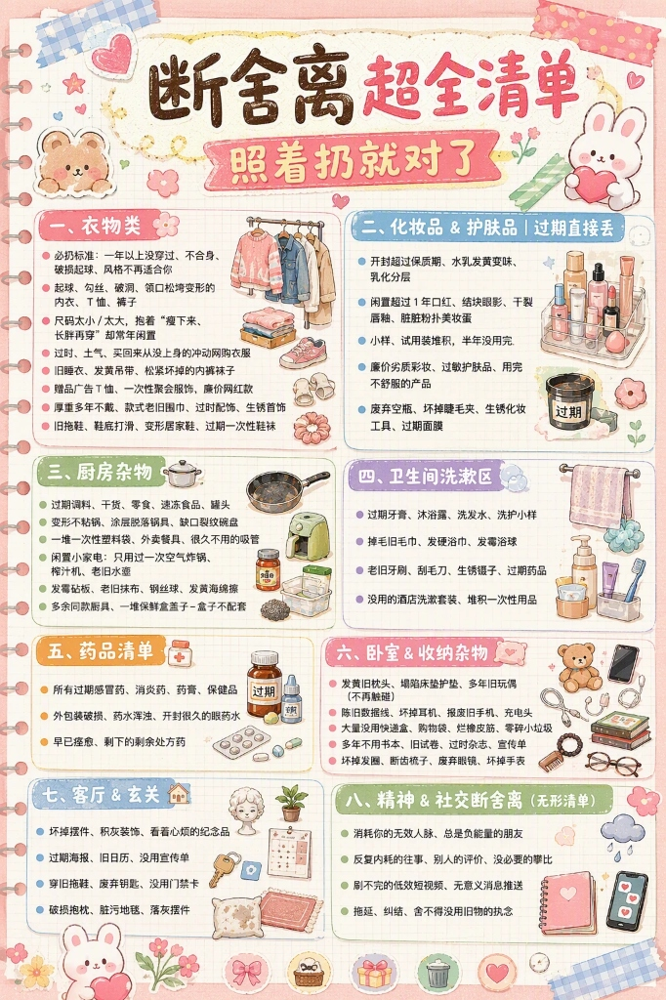

14. **`ref-14-knowledge-card-golden-5-elements.jpg`**：知识卡片设计黄金五要素规范（内容精准、风格统一、版式干净、配色高级、细节精致）

    


---

## 📱 社媒发布红线与平台参数规约 (Platform Publishing Constraints)

为杜绝手动或自动发布时被各大自媒体平台截断或弹窗阻断，所有文章生成与排版必须严格执行以下物理红线：

### 📕 1. 小红书 (Xiaohongshu) 独立赛道铁律与美少女手账体系

#### A. 核心定位与视觉人设（彻底与技术博客轨分离）
- **长文博客轨（掘金/知乎/CSDN/公众号）**：深蓝卫衣黑框眼镜极客青年 + Style 12（16:9 横屏）；
- **小红书独立图文轨**：**日漫美少女学霸手账系列 (Anime Studygram Girl)**，治愈系马卡龙配色，高亲和力、元气学霸形象。

#### B. 核心参数与发布红线

| 维度 | 官方硬性限制 | 老王工程建议值 (防翻车) | 核心暗坑与技术细节 |
| :--- | :--- | :--- | :--- |
| **标题字数** | **≤ 20 字符** | **16 ~ 19 字符** | 超过 20 字符直接弹窗阻止发布！所有标点、空格、Emoji 全计入 1 字符。建议留 1 字符安全边距。 |
| **正文字数** | **≤ 1000 字符** | **≤ 850 字符** | **暗坑预警**：小红书后台统计**全量字符**（包含所有 `\n` 回车换行符、空格、标点与 Emoji）。若空行过多，纯文本 600 字也会爆破 1000 字上限导致阻断。编写时必须用脚本校验总长度 ≤ 850 字符。 |
| **图片规格** | 1 ~ 9 张（最多9张） | **3 ~ 9 张**（首图吸睛+多步拆解+避坑清单） | **强制分辨率：`1152x1536`（严格 3:4 满屏）**！<br>⚠️ **黑边死穴警示**：千万别用 `1024x1536`（2:3）！小红书 App 图片容器按 3:4 锁死在 632px 高度。传 2:3 会因为过高而等比缩窄，导致**左右两边被强制塞入各 26px 黑边（Letterboxing）**！只有 `1152x1536` 才能左右贴边 100% 满屏显示！ |
| **知识密度** | - | **高密度手账卡片** | 坚决杜绝空洞大头贴！每张图片内必须充满**4~5个核心知识卡片、S型猫爪流程轨迹、打勾清单项、架构拓扑或万能公式**。 |
| **资产隔离** | - | `assets/images/xiaohongshu/<slug>/` | 每篇图文必须建立专属文件夹，图片命名严格为 `p01-cover.png`, `p02-xxx.png` ... `p09-xxx.png`，在 Finder 中按 `Cmd+A` 即可按序批量拖拽上传，绝不乱序。 |
| **话题标签** | 计入正文总字数 | **4 ~ 6 个标签** | 放置在正文底部（如 `#AI应用开发 #程序员日常 #手账指南`），标签字符一并计入 1000 字配额。 |

#### C. 小红书美少女角色图库 (Character Gallery)
在后续撰写小红书笔记时，可根据技术专题类型从以下 4 款美少女 IP 中挑选作为封面与知识卡主角：

| 角色编号 | 角色代号 & 对应形象 | 适合技术专题 | 资产路径 | 视觉特征 |
| :--- | :--- | :--- | :--- | :--- |
| **Char 01** | **元气紫卫衣 · 高马尾学霸**<br>*(Lavender Ponytail)* | AI Agent 认知循环、思维链解构、方法论指南 | `assets/images/xiaohongshu/characters/char-01-ponytail-lavender.png` | 薰衣草紫连帽衫、高马尾、圆黑框眼镜、单眼眨眼握拳、元气满满 |
| **Char 02** | **薄荷活力 · 双马尾刷题少女**<br>*(Mint Twintails)* | RAG 检索增强、面试高频八股真题、算法速查 | `assets/images/xiaohongshu/characters/char-02-twintail-mint.png` | 薄荷绿卫衣、齐刘海双马尾、金丝细圆框眼镜、手持荧光笔、甜美wink |
| **Char 03** | **知性深蓝 · 短发极客少女**<br>*(Navy Bob Geek)* | 系统高可用设计、架构设计、高并发与避坑防崩溃 | `assets/images/xiaohongshu/characters/char-03-bob-geek.png` | 深蓝粗麻花毛衣、齐肩波波头短发微翘、大黑框眼镜、颈挂金属大耳机、托腮睿智笑 |
| **Char 04** | **元气暖黄 · 丸子头工科少女**<br>*(Warm Bun Tinkerer)* | 大模型微调/量化、Prompt 工程调试、生产实操踩坑 | `assets/images/xiaohongshu/characters/char-04-bun-warm.png` | 暖黄工装衬衫、丸子头插黄色铅笔、大黑豹纹圆框眼镜、笑逐颜开、动手能力超强 |

#### D. 小红书图文流三大标配板块
1. **P01 封面**：治愈工坊美少女书桌（超大加粗手绘日漫中文标题 + 浮空白蓝小机器人 + 和纸胶带）；
2. **P02~P0X 核心拆解**：**Style 05（日漫美少女 S 型猫爪通关手账）**，S型虚线穿过 5 个步骤卡片，配少女不同姿态插画；
3. **P末 落地清单 & 开源底座展台**：**Style 11（萌系马卡龙立体便签打卡卡 ＋ 开源项目展台）**：
   - 上半部：4 大立体马卡龙便利贴自检打勾清单；
   - 下半部：**【官方开源项目 ai-agent-platform 豪华展台】**（藏青深蓝底金色发光大卡片，标明三层微服务拓扑 `前端平台 web` ➔ `后端服务 api` ➔ `执行引擎 runtime`、3 大核心亮点与 GitHub 直通车）；
   - 底部：少女趴桌甜笑 + 迷你 AI 机器人拉出卷轴横幅。

---

### 💻 2. 知乎 / 掘金 / CSDN / 博客园 (长文四大核心平台) 规约

- **平台收敛铁律**：长文技术博客**绝对收敛至【知乎、掘金、CSDN、博客园】四大核心阵地**，其他平台（如微信公众号、语雀、简书、头条等）暂时不发布，杜绝精力分散。
- **标题**：建议 25~35 字，包含场景痛点与技术关键词。
- **正文**：支持完整 Markdown 语法与代码块（推荐 2000~4500 字技术深度长文），严格剥离 AI 油腻感（遵守 humanizer 规范）。
- **配图铁律（除小红书外全线锁定 Style 12）**：
  - **首图 Hero Banner**：工坊治愈手账动漫风（戴黑框眼镜穿深蓝卫衣的极客青年 + 悬浮白蓝小AI机器人敲代码，横版 16:9 `1536x864`）；
  - **章节小结与知识卡片**：**强制锁定「Style 12：工坊极客小机器人手账卡 (Geek Workshop Robot Sketchnote)」**，16:9 宽屏（`1536x864`），左上角带 `佳欣的AI工坊 ✧ @ljxpython` 胶带，右上角悬浮白蓝小机器人拉引线划重点，纯中文零乱码，严禁插入竖版 2:3/3:4 撑破单屏；
  - **系统级宏观拓扑**：凡涉及端到端系统架构、复杂流程、状态机，**一律强制调用 `/archify` 生成交互式 SVG/HTML**（收录至 `assets/architecture/`），坚决弃用扩散大模型生图。
- **发布渠道**：使用 `WechatSync` 一键同步到四大平台草稿箱，无缝保留图片与排版。

---

### 🛡️ 3. 技术长文配图心流节奏与生图字形防翻车铁律 (Visual Cadence & Typography Defense)

#### A. 视觉心流节奏（因文施策，拒绝疲劳）
- **章节脉络自由舒展**：严禁八股套路，具体文章的大纲结构、推导深度根据具体技术痛点和场景自由设计（如排错排查类、架构剖析类、源码解密类、选型对比类各有各的逻辑流）；
- **动态知识配图节奏**：严禁连续多个小节全是高密度纯文本。根据内容密度自然断句，通常**每输出 2~3 个核心概念或深度模块后，适时插入一张 Style 12 知识小结卡片**做认知休整与干货锚定；
- **篇末终极结案**：全篇总结落地章节末尾，**配备一张提炼核心工程哲学的万能公式卡**。

#### B. 中文生图字形防翻车六大原则（彻底消灭错别字与笔画形变）
大模型在绘制中文时极易出现形近字混淆与粘连（如“立宪”变“立志”、“踩坑”变“踩坊”、“向量”变“向重”）。出图必须严格执行以下工程防御：
1. **高频高容错字原则**：
   - 坚决杜绝在卡片中放入笔画极其繁复或生僻易混淆的词组；
   - 统一选用笔画稳固、高频常见的标准字（如：“确立规则”替代“立宪定规”，“实战打磨”替代“踩坑踩出”，“结构化文件”替代“复杂向量库”）；
2. **气泡框文案极度克制**：
   - 悬浮小机器人气泡框文案必须控制在 **≤ 15 字**，字大句短，禁止塞入复杂复合句；
3. **文本必须用反引号包裹**：
   - 画面中所有需要绘制的文字必须用反引号（`` ` ``）严格包裹；
4. **防插图周边涂鸦乱码**：
   - 画面中的小电脑、小画板等插图周围，**必须在提示词显式严禁涂鸦乱码**：`Clean illustration ONLY, ABSOLUTELY NO floating decorative doodle words or scribble characters around laptop/board`，根除类似“开源·月广屋”等火星文；
5. **拓扑胶囊文字大字直白化**：
   - 架构拓扑胶囊内严禁嵌套带括号的拥挤小字（如不要写 `platform-api (后端)`，容易导致“后”粘连变形为“荷”），统一采用直白稳固词组（如 `前端平台 web`、`后端服务 api`、`执行引擎 runtime`）；
6. **提示词防呆负向约束与验收硬性断言**：
   - 提示词末尾必须注入标准负向禁令（NO garbled pseudo-Chinese characters, NO typos）；
   - 图片生成后，**必须强制调用 `view_file` 放大核验卡片内的每一个汉字**！一旦发现字形变形或错别字，立即重构提示词重新生成，严禁带病入库！
