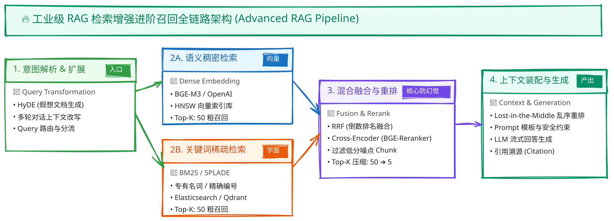

# Excalidraw 思维导图与白板架构资产库

本目录专门存放用于强化记忆、文档嵌入、面试幻灯片 (knowledge-deck) 以及知识站 (knowledge-site) 的手绘风白板图。

## 🎯 资产格式约定

推荐每个导图同时保留两种格式（或至少保留 SVG）：
1. **`.svg`**（必需）：直接在 Markdown、HTML 中引用，高保真矢量缩放，加载极快，零文字模糊。
2. **`.excalidraw`**（推荐）：Excalidraw 的 JSON 源文件，随时可拖回 [excalidraw.com](https://excalidraw.com) 进行二次修改与迭代。

## 🗂️ 命名规范

```
assets/excalidraw/
├── 01-llm-transformer-arch.svg       # Transformer 结构推演
├── 02-rag-hybrid-search-rerank.svg   # RAG 混合检索与重排序完整链路
├── 03-agent-react-loop.svg           # ReAct 循环与死锁防护
└── ...
```

## 🔗 在文档中的引用方式

在 Markdown 题库、知识站或 Deck 胶片中：
```markdown

```
